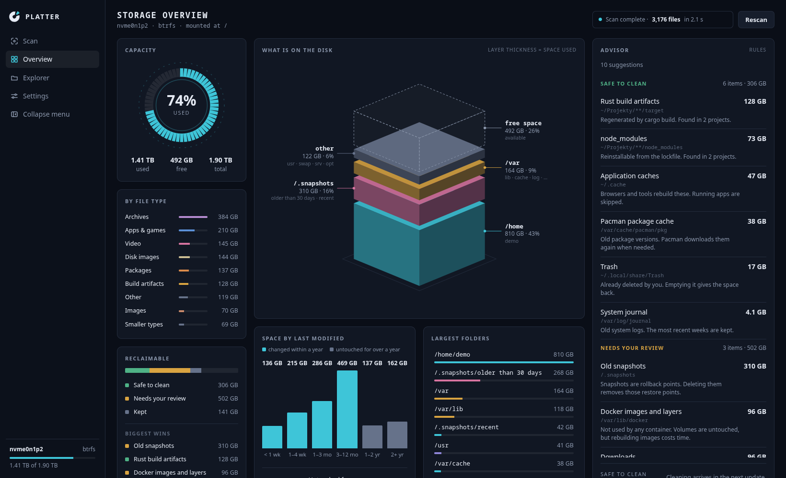
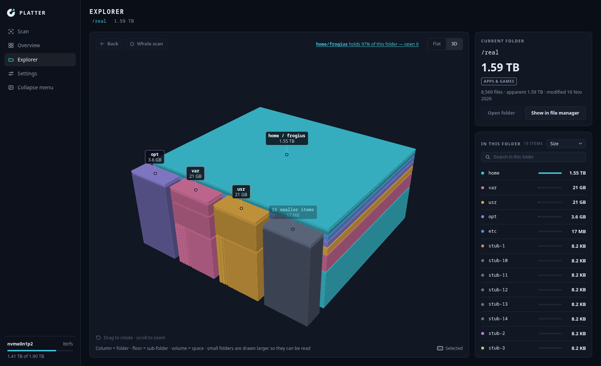
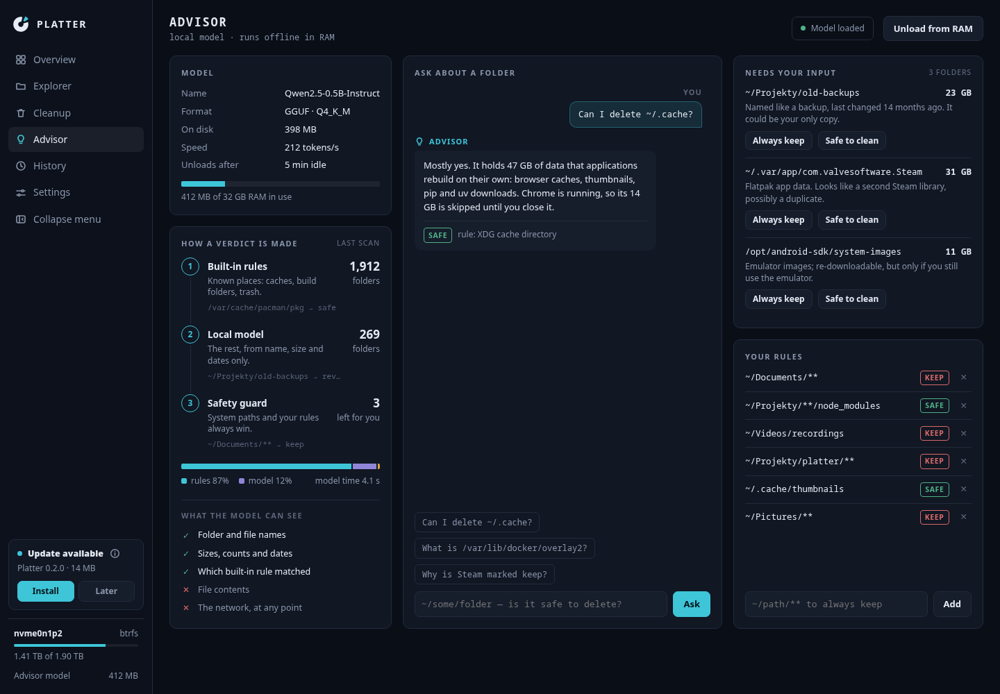
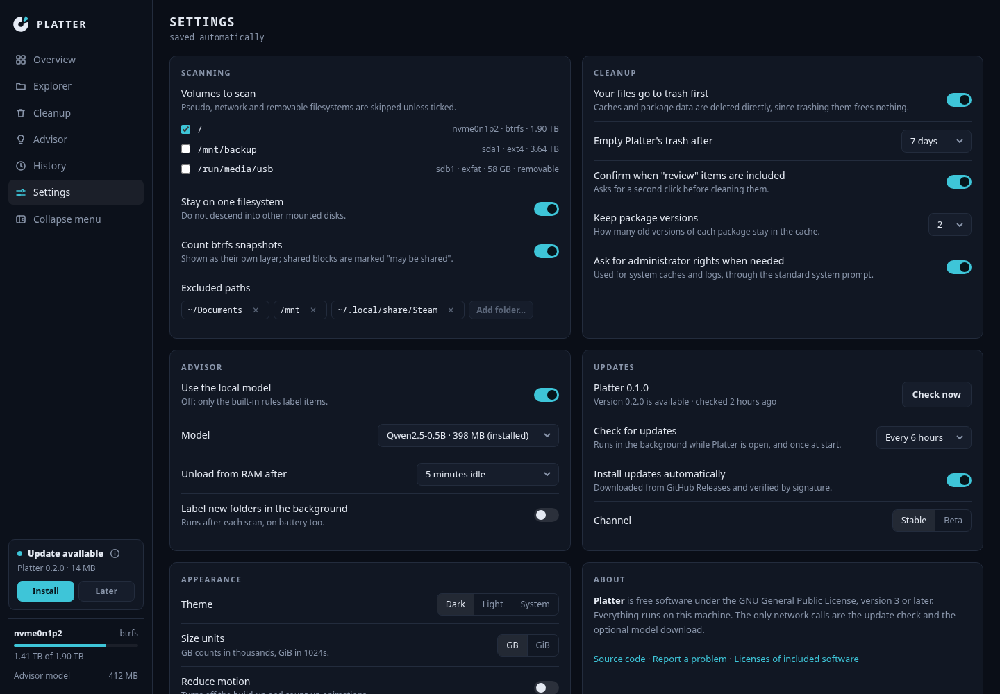

# Platter: what is built and what comes next

This is the hand-over for whoever continues the work. Read it top to bottom once, then pick one work package at a time from "Work packages". Each package is sized to be done, verified and committed on its own.

Other documents:

- `docs/architecture.md` is the binding contract (crates, ports, scanner rules, IPC types, suggestions). Change it first, then the code.
- `docs/mockups/` holds the HTML mockups the owner approved. They are the visual truth. Open them in a browser; do not copy their code wholesale.
- `docs/plan/screens/` holds screenshots: `target-*.png` is how a view must look (taken from the mockups), `built-*.png` is how the app looks today on mock data.

## 1. State today

Built and working (milestone 1 plus read-only suggestions):

| Area | What exists |
|---|---|
| Scanner | Parallel walker, hardlink dedupe, "same disk" mount rule (btrfs subvolumes included), memory budget, cancel, warnings. Matches `du -s -B1` exactly on real folders. |
| Queries | Children (paged, sorted), level-of-detail tree, path, summary (file types, age, largest folders), node flags `unreadable` and `skipped`. |
| Rules | `platter-rules`: read-only suggestions with verdict safe / review / keep. No code that deletes anything; a lint and a test enforce that. |
| Desktop app | Scan screen, scan progress, Overview (three columns as in the mockup, Advisor list without controls), Explorer (flat map, 3D columns, list with search), Settings (three working settings). |
| CLI | `platter-cli volumes`, `scan`, `suggest`, `export-fixture`. |
| CI | `.github/workflows/ci.yml`: Rust, web, dependency audit. Never run on GitHub yet. |

Screens as built (mock data):

| Scan | Overview |
|---|---|
|  |  |

| Explorer, flat | Explorer, 3D |
|---|---|
|  |  |

Checks at hand-over, all passing: 384 Rust tests, 540 frontend tests, clippy, rustfmt, eslint, prettier, svelte-check, cargo-deny.

### Known gaps (do these before or alongside new features)

1. **R1 is done; its fixes were not re-reviewed.** The review found one High (name rules labelled tools' `node_modules` and localised personal folders `safe`) and eight Medium findings. The rules, Explorer and CLI findings were fixed on 2026-11-16; the owner chose to skip a fresh review of those fixes and move on. Two Medium findings are not fixed in code but written into C1 and C4 below as requirements (mount roots and file identity are not in the tree; the web view chooses the scan root). Open Low findings are listed under R1.
2. **Never verified in the real app window by a tool.** All screenshots come from headless Chrome on mock data. The app window uses WebKitGTK, which differs: it ignored the standard scrollbar CSS, did not reserve a scrollbar slot, and showed a focus ring after mouse clicks. The owner checks by eye. Items still unconfirmed by the owner: thin scrollbars, list right edge, 3D camera fit, window icon, focus ring.
3. **Mock and real backend differ in places.** The mock's `largestDirs` uses an older rule; the mock omits `skipped` and `sharedFiles`. Tests on the mock can pass while the real app shows something else.
4. **Scan warnings are not shown.** `finished.warnings` (`mountTableUnavailable`) reaches the frontend and is ignored.
5. **btrfs shared blocks.** A scan of `/` reports about 114 GB more than `df`, most likely snapshots and reflinks sharing extents. The UI does not say so.
6. **Trash totals with hard links.** A suggestion's size can differ from what deleting frees; `sharedFiles` carries the count but the UI does not show it.
7. **Leftovers.** `scripts/dev/desktop-entry.sh` installs a desktop entry for local builds; packaged builds need their own (package D1).

## 2. Rules that apply to every package

These come from the owner's feedback during design and the first build. Breaking them was the main cause of rework.

**Design**

- Match the mockup. If a feature is not built yet, leave its controls out; never show fake data or dead buttons. Do not rearrange an approved layout to fill a gap; ask.
- Flat styling: no gradients, no glows. One accent colour (`--accent`). Green means "safe" and nothing else.
- Cards in a row end at the same height. No empty space inside a card, and no stretching row spacing to fill one.
- One left edge and one right edge per card: titles, inputs, dots, numbers and separators line up. Measure it.
- No layout shift on hover, selection, or when a scrollbar appears.
- Confirmations are a `<dialog>`, never a button that turns into another button.
- Labels: cut names at the end, never in the middle; show a size in full or not at all.
- A folder has one colour everywhere (`apps/desktop/src/lib/folderColor.ts`): the largest child inherits its parent's colour, the others take the palette in order.

**Verification**

- Look at the result. Take headless screenshots and compare them with the mockup side by side; measure edges with PIL.
- Test with skewed data, not only the balanced mock. `?root=/real` is a mock shaped like a real disk (one folder holds 97%). Add scenarios like it for new views.
- Headless Chrome is not the app window. Do not rely on `scrollbar-gutter`, `scrollbar-width`, `scrollbar-color` or `:focus-visible` after a click. State plainly what was not checked in WebKitGTK.
- Screenshot command (zsh does not split unquoted variables, so write flags inline; the GL flags are required for the 3D view):

  ```
  google-chrome-stable --headless=new --use-gl=angle --use-angle=swiftshader --enable-unsafe-swiftshader \
    --hide-scrollbars --window-size=1640,1000 --virtual-time-budget=8000 \
    --screenshot=out.png "http://localhost:4173/?view=overview&static"
  ```

  URL hooks (ignored inside the app window): `view=start|scanning|overview|explorer|settings`, `static`, `mini`, `root=/real|/skew|/home/demo`, `dominant`, `mounts`, `ready`, `ex=flat|3d`, `focus=<id>`, `pick=<n>`.

**Safety**

- Never create large test trees on disk. An agent once used every inode of `/tmp` with millions of hard-linked files. Use the in-memory fake filesystem (`platter_core::testing::FakeFs`); keep real fixtures under a few thousand entries, and never under `/tmp` at scale.
- `unsafe_code = "forbid"` for the whole workspace. OS-specific code only in `platter-platform`.
- The web view has no Tauri permissions (`capabilities/default.json` is empty). It may never pass a path or URL to the backend; it names a node id from a scan.
- Signing keys for the updater are created by the owner, never by an agent.
- Commit or push only when the owner asks.

**Process**

- One package at a time. Workers on overlapping files conflict; split by folder (`features/overview`, `features/explorer`, `crates/…`).
- After each package run: `cargo fmt --all -- --check`, `cargo clippy --workspace --all-targets -- -D warnings`, `cargo test --workspace`, `cargo deny check`, and in `apps/desktop`: `pnpm lint`, `pnpm check`, `pnpm test`, `pnpm build`.
- Build and start the app: `pnpm -C apps/desktop tauri build --no-bundle`, then `target/release/platter`.

## 3. Order

1. R1 (reviews), F1–F4 (small fixes).
2. Cleanup: C1–C7. This is the point of the app.
3. Advisor model: A1–A4.
4. History: H1–H2.
5. Distribution and updates: D1–D4. Needs the owner's signing keys.
6. Settings completion: S1.
7. Windows and macOS: P1–P2.

The owner may reorder. Cleanup before Advisor is fixed, because the model only labels what the rules do not cover.

## 4. Work packages

### R1. Review the newest work (before any deleting code)

- **Scope:** read-only correctness review and security audit of `crates/platter-rules/**`, `crates/platter-core/src/budget.rs` and its callers, `crates/platter-platform/src/linux/{open,same_fs,snapshot}.rs`, `apps/desktop/src/lib/features/{explorer,overview}/**`, `apps/desktop/src/lib/folderColor.ts`, `scripts/dev/desktop-entry.sh`.
- **Focus for rules:** every way a name or layout can make something precious be labelled `safe` (a personal folder named `target` beside a `Cargo.toml`, `node_modules` beside a `package.json`, `~/.cache` holding things users put there, `HOME` set oddly, a scan root that is itself matched). Check that `Tree::shared_files` is correct (it relies on descendants at one depth forming one contiguous id run).
- **Done when:** findings are fixed or listed with a decision; no High finding open.

- **Status (2026-11-16):** done. Fixed: `keep` wins over every rule and is never entered; a scan inside a kept folder suggests nothing; personal folders come from XDG `user-dirs.dirs` (Desktop, Documents, Music, Pictures, Videos under any name); without a known home, name rules are at most `review`; a folder with an unreadable part is never `safe`; `node_modules` needs a lockfile and is never matched inside tools' folders (`.nvm`, `.vscode*`, `.cursor*`, `node_modules`, ...) or below `/usr` and `/opt`; markers must be regular files; `~/.cache`, `~/.m2/repository`, the journal and the pacman cache are `review`; `HOME=/` counts as unknown; the CLI pins the scan root's identity; `desktop-entry.sh` quotes `Exec=` and refuses unsafe paths; Explorer: the "smaller items" tile stops loading at 5,000 rows, a chain tile's details, Open and Reveal all describe its last folder, zero-size rows are never hidden.
- **Open Low findings:** a name-limit hit is reported as a memory limit (`scan/mod.rs`, needs a `ScanLimit` variant); the memory budget is per scan, not per process, and blocking queries are not bounded; the read-only check of `platter-rules` can be bypassed (`build.rs`, aliases, `#[allow]`); the scan root itself can be claimed by a fixed or home rule (C1 refuses the scan root); folder colour below depth 12 differs between navigating and a deep link; 3D view rebuilds the scene when a colour arrives late; percentages round 99.6% up to "100%"; the disk stack can be clipped at the top on btrfs; smaller list and search issues; stale Explorer id when `openInExplorer` runs during a rescan; a pnpm workspace's member packages have no lockfile next to them, so their `node_modules` are no longer suggested.

### F1. Show scan warnings and hard-link notes

- Show `finished.warnings` on the Overview as one muted line under the status pill ("Mounted disks could not be read, so only this disk's own files were counted").
- In the Advisor row, when `sharedFiles > 0`, add to the reason: "N files are also linked from elsewhere, so the space freed can differ."
- Files: `features/overview/**`, `state/scan.svelte.ts`. Tests on both.
- **Status (2026-11-16):** done. `ReadyScan.warnings`, `features/overview/scanWarnings.ts`, `advisor.ts` `reasonOf`. Mock hook `?warn` shows the line. Not checked in the WebKitGTK window.

### F2. Make the mock match the backend

- Port the current `largestDirs` rule (see `docs/architecture.md`) to `apps/desktop/src/lib/api/mock.ts`; add `skipped` to mock mount nodes and `sharedFiles` to mock suggestions.
- Better: generate the mock tree from a real `platter-cli export-fixture` run on a synthetic folder, so the two cannot drift. Never commit a fixture made from a real home folder (it contains private names).
- **Status (2026-11-16):** done by porting, not by fixture: `mock-summary.ts` (`largestDirs`), `mock-lod.ts` (heap admission as `query/lod.rs`), `mock-dto.ts` (`unreadable`, `skipped`), `mock-suggestions.ts` (the full rule table and `evaluate.rs` behaviour, with `sharedFiles`). Still different: directory categories from names, file categories from extensions, hard-link accounting, XDG folder names, `totals.errors`/`dirs` of the finished event, non-ASCII names. Backend questions it raised: on a real-shaped disk Largest folders shows one huge folder then tiny ones (`stub-1`…); LOD stops one item early when the last sibling would replace the placeholder; a collapsed node of only empty items gets category `video`; the `disk-images` reason says "1 GiB" whatever unit is set.

### F3. Name filter in the backend

- `get_children` gains an optional `query` (case-insensitive substring on the name). The Explorer's search then works on any folder size; remove the 5,000-item cap and background page loading in `features/explorer/state/explorer.svelte.ts`.
- Contract change first. Tests in core (`query/children.rs`) and the store.
- **Status (2026-11-16):** done. Backend: `query::NameFilter`, `children_matching`, `get_children` `query` (max 1024 bytes). Frontend: the store asks the backend after a 150 ms pause and drops stale answers; the search cap and background loading are gone (the 5,000 cap remains only for the "smaller items" tile); the search box takes at most 255 characters. Header counts are sized items on both sides ("12 of 143 items"). Not checked in the WebKitGTK window.

### F4. Explain shared space on btrfs

- When the scanned volume is btrfs and scanned bytes exceed the volume's used bytes, show one line on the Capacity card: "Some files share disk blocks (snapshots or copies), so folder sizes add up to more than the disk uses."
- No new measurement; compare `Totals.allocated` with `VolumeDto.total − available`.
- **Status (2026-11-16):** done in `CapacityCard.svelte` with tests; no screenshot, because the mock never scans more than the disk uses.

---

### Cleanup

Target screens:

| Overview with controls | Review dialog |
|---|---|
|  |  |

| Cleanup, scanning | Cleanup, review |
|---|---|
|  |  |

Explorer with marking (target): 

Design decisions already made with the owner:

- The Cleanup view's left side is the **flow chart** (groups on the left, ribbons to "Will be freed" or "Stays on disk"); see `docs/mockups/c-orb.html`. The owner rejected an orbit, tiles, and a gauge with bars.
- The right panel reuses the Overview's Advisor list pattern: "Select Safe | All | None", grouped rows with a checkbox, reason always visible, total, status text, "Clean safe · X" and "Clean selected (n)".
- Items that need review open a `<dialog>` listing them before anything is cleaned.
- Caches and package data are deleted directly (trashing them frees nothing). The user's own files go to the trash first.
- Group headings in the Advisor list scroll with their rows; they do not stick.

#### C1. Cleanup plan and guard (backend, no deleting yet)

- New module in `platter-rules` or a new crate `platter-cleanup`: `CleanupAction = Trash | Delete | RunTool { program, args, needs_elevation }`, and `CleanupPlan` built from selected suggestion ids. A plan records for each target `(dev, ino, size, mtime)` from the scan.
- `VerifiedTarget`: a type only the guard can construct. The guard rejects: the scan root, `/`, the home directory, mount roots, anything outside the scan root, anything whose verdict is `keep`, anything matched by a deny-list of paths (`~/.ssh`, `~/.gnupg`, `~/Documents`, `~/Pictures`, …), symlinks, and unreadable nodes. Compare canonical paths component by component.
- Dry run: returns what would be removed and how much, without touching disk.
- **From the R1 review, the guard must not assume from the tree:** (1) identity: the tree records no device, inode or mount id per node and not the root's identity, so `(dev, ino)` for a plan has to come from `statx` by descriptor at plan time; (2) mounts: a `Dir` node can be a mount the scan entered (a btrfs subvolume or a bind mount, possibly of data from outside the scan root), so check `STATX_ATTR_MOUNT_ROOT` and the mount id at every level, also while recursing; (3) paths: `SuggestionDto.path` is a display glob and `get_path` is lossy, only `path_bytes` is exact; (4) `SuggestionDto.nodes` holds at most 20 nodes, re-evaluate to get every match; (5) sizes: `allocated` is not what deleting frees (hard links, reflinks, snapshots); (6) freshness: the tree is a snapshot, so re-check each target and its rule right before acting; (7) the deny-list compares the canonical home and the XDG personal folders by identity, not by text. Put this code in a separate `platter-cleanup` crate, not in the read-only `platter-rules`.
- Tests on the fake filesystem for every rejection. Property test: no plan can contain a path outside the scan root.
- **Done when:** `platter-cli clean <path> --dry-run` prints a plan and nothing on disk changes.
- **Status (2026-11-16):** done. New crate `crates/platter-cleanup` (`action.rs`, `protect.rs`, `guard.rs`, `plan.rs`); port `EntryProbe` in core with `LinuxEntryProbe` (`platter-platform/src/linux/probe.rs`) and a `FakeFs` implementation (plus `swap_for_symlink` and `remove` to change the fake after a scan); `platter_rules::matches` gives every match. Tests: one per refusal (`tests/guard.rs`), a seeded property test over 400 random trees with links, mounts and unreadable folders (`tests/property.rs`), the Linux probe on real temp files, and `platter-cli clean` on a temp home (`crates/platter-cli/tests/clean.rs`). Not done here: the deny-list compares paths, not identities (point 7 above); elevation is only recorded per tool, not detected per path (C3); `go-modules` files are read-only and the Trash folder is emptied whole (`files/` and `info/` go too): C2 has to handle both.

#### C2. Guarded execution (backend)

- Execute accepts only `VerifiedTarget`s, re-verified at execute time: open the parent directory by descriptor, `statx` the entry with `AT_SYMLINK_NOFOLLOW`, compare `(dev, ino)` with the plan, then `unlinkat`. Recursive deletes walk by descriptor, never by path string. Reuse `platter-platform/src/linux/open.rs`.
- Trash: implement the freedesktop trash spec in `platter-platform` (same-filesystem trash directory, `.trashinfo`), or use the `trash` crate after checking it does not follow symlinks.
- A hard-linked file frees nothing unless every link is in the plan; report freed bytes from before/after `statvfs`, not from the plan.
- Progress events per group; cancel between targets, never mid-target.
- Tests: swap a directory for a symlink between plan and execute (must refuse); delete a tree with a mount inside (must stop at the mount); permission errors are reported per target and do not abort the run.
- **Done when:** the CLI can clean a temp tree and the test suite proves the refusals.
- **Status (2026-11-16):** done. Port `EntryRemover` (core), `LinuxEntryRemover` (`platter-platform/src/linux/remove.rs`) and the freedesktop trash (`linux/trash.rs`), `platter_cleanup::execute`, `platter-cli clean --yes`. Tests on real temp folders (`platter-platform/tests/remove.rs`): a link inside is removed, not followed; a folder or a folder on the way swapped for a link after the plan is refused and nothing is touched; another folder under the same name is refused; read-only folders are emptied; an unreadable folder inside is reported and the rest removed; a mount on the way (`/proc`) is refused; a tmpfs mounted inside the folder is left alone (run in an unprivileged user and mount namespace, skipped where those are not available); trashing writes the record and picks a free name. Runner tests with a recording remover (`platter-cleanup/tests/execute.rs`); CLI test cleaning a temp home. Follow-ups done the same day: an entry on another disk goes to that disk's `.Trash-$uid` (owner and mode checked; tested in a namespace with a tmpfs); `DeletionDate` is local time (`platter_platform::localtime`, TZif and POSIX footer rules); emptying the trash keeps `files/`, `info/` and `expunged/` and drops `directorysizes`; system caches go through their tools (C3). Still not done: the shared `$topdir/.Trash/$uid` is not used; the `directorysizes` cache is not updated when Platter trashes something.

#### C3. Owning tools and elevation

- Package caches and logs are cleaned by their own tool: `paccache -rk2`, `apt-get clean`, `dnf clean packages`, `journalctl --vacuum-time=2weeks`, `docker system prune`. Each is a `RunTool` with fixed arguments; the UI never supplies arguments.
- Elevation port in `platter-platform`: `pkexec` with a shipped polkit policy on Linux. One prompt per run.
- **Done when:** a system-cache cleanup works on the owner's machine through the system password prompt, and a refused prompt is reported cleanly.
- **Reviews (2026-11-16):** an independent correctness review and a security audit of C1–C3: no High finding. Fixed: protected places compared by identity as well (Medium; a bind mount of the home got past them); freshness re-checked for files (time and length) and project markers, at plan time and before acting (Medium; contract point 6); trash parts must sit in the planned trash folder; `fchmod` only on `EACCES`, adding owner bits and restoring the mode; the time-zone reader cannot overflow, falls back to its table, reads only regular files without blocking, accepts `TZ` rules; a missing `pkexec` and a tool's own 126/127 are no longer "password not given"; Docker is pinned to the local daemon; the runner executes the canonical program path with every ancestor checked; `Tool` and the plan's root are sealed; the home trash must belong to the user; long names fit in the trash; the CLI's exit code and wording (mounts left alone, nothing cleaned, a named rule found nothing, trash-only runs); cancel still closes its group; both free-space readings are taken after `syncfs`; a malformed scan root path is reported as such; the deny-list gained `~/.var`, `~/snap`, `~/.aws`, `~/.kube`, `~/.netrc`, `~/.git-credentials` and `~/.local/share/kwalletd`. A second, scoped review of the repairs confirmed them and found one more Medium (a protected place reached through a link, such as a dotfiles `~/.config`, was not protected): fixed, the place is now protected where it really is (`EntryProbe::resolve`, used only for protected places), with a test from both scan roots; folders above the home are now known by identity too; `syncfs` runs only on btrfs. The open points were then closed (2026-11-16): every look at the disk during planning has a 3 s limit (`TimedEntryProbe`), so an automount or a dead network share cannot stall it; trashing inside a nested btrfs subvolume uses that subvolume's `.Trash-$uid` (tested on a real subvolume); folders are emptied in batches of 1024 names, read again until a pass removes nothing, with at most 100 problems kept in detail (`Removed::note`, `more_errors`); `Platform::environment_for(scan_root)` treats a second path to the home or a personal folder (bind mount) as that folder, so suggestions label it `keep` too (tested in a namespace). Not done: the shared `$topdir/.Trash/$uid` is not used; a thread stuck in a hung lookup stays stuck (it cannot be interrupted), the plan just stops waiting for it.
- **Status (2026-11-16):** built, not yet checked on the owner's machine. Port `ToolRunner` (core), `LinuxToolRunner` (`platter-platform/src/linux/tools.rs`): programs only from root-owned system folders, cleared environment, `pkexec` for elevated tools, 126/127 = password not given. The runner stops prompting after one refusal. Core dumps use a fixed elevated `find ... -xdev -mindepth 1 -delete`. Not done: one prompt per run needs a shipped polkit policy and helper (packaging, D1); today each elevated tool asks. **Owner check (2026-11-16): passed.** `platter-cli clean /var/cache --rule pacman-cache --yes` with the password: `paccache -rk2` ran (cache 13.8 GiB to 11 GiB); with the prompt dismissed: "the administrator password was not given", exit code 1. That run showed "Free space grew by 0 B": btrfs frees deleted space only at its next commit, so the runner now calls `syncfs` before measuring (checked: a 286 MiB build folder on btrfs reports 286 MiB freed), and a 0 after a successful clean is worded as "not changed yet". The plan used to refuse the pacman cache because pacman's `download-*` folders are root-only; a part Platter cannot read no longer blocks a rule its tool cleans.

#### C4. IPC and state

- **Status (2026-11-16):** backend done. `apps/desktop/src-tauri/src/commands/cleanup.rs`: `plan_cleanup`, `start_cleanup`, `cancel_cleanup`, `undo_cleanup`; `CleanupRegistry` (plans by id, single use, 10 min, at most 4; one run at a time; last 4 runs kept for undo); native confirmation (`NativeConfirm`, `tauri-plugin-dialog`, set in `setup`; `RefuseAll` until then and in tests) built from the backend plan, for every plan (see Reviews below); scans outdated after any run (`ScanRegistry::disk_changed`); `start_scan` refuses roots the backend did not offer (`AppState::allow_roots` from `list_volumes` and `pick_folder`); `EntryRemover::restore` and `platter_cleanup::undo` for undo. Tests: plan validation and description, declined confirmation, an approved run with its events on a real temp folder, outdated scans, one run at a time, undo once, the confirmation text, the root allowlist over IPC. Frontend: `types.ts`, `client.ts` (`planCleanup`, `startCleanup`, `cancelCleanup`, `undoCleanup`), `tauri.ts`, `index.ts`, `mock-cleanup.ts` (same validation, single use, one run at a time, events, outdated scans, undo once; no guards, no failures, no confirmation, at most the 20 largest matches per rule; trashed items free nothing), `ReadyScan.outdated` and `ScanStore.markOutdated`. Not checked in the app window yet: the native dialog itself (owner check once C5 has a button). **Reviews (2026-11-16):** a correctness review and a security audit of C4, no High finding. Fixed: moving to the trash is confirmed too, and the dialog shows every group first (with the trash's size), then paths shown safely (escaped control and bidi characters, shortened, capped) (Medium, audit M1/M2); the running slot is a guard freed however a run ends, a failing dialog counts as "no", results reach undo even after a panic, and `failed` names the outdated scan (Medium, review); the plan and scan are checked again after the dialog; an empty plan cannot start; one plan is made at a time; refusals are capped; a 2 s pause after a declined dialog; every finished scan, and one running at the time, is outdated after a cleanup or an undo (`ScanRegistry::disk_changed`); undo checks the `.trashinfo` record, forgets runs that trashed nothing and all runs once the trash is emptied, and keeps failed entries for another try; a picked folder is pinned by identity; quitting waits for the item in progress. A scoped re-review of the repairs confirmed them and found only Lows, all fixed: line and paragraph separators and more invisible characters are escaped (paths shortened before escaping); undo is refused while a cleanup runs and keeps its entries if it fails; quitting does not wait for a run still at its dialog; a pick without a readable identity is refused (and read off the async worker); `failed` carries `canUndo` and `cleanupId`. Open: on Linux the dialog's parent window is ignored (rfd's GTK backend passes none; it is still modal); focus behaviour and long text in GTK are owner checks with C5; a reloaded web view loses the `cleanupId` of a run it started (C5/C6 must not rely on keeping it).

- **Requirements from the cleanup security audit (2026-11-16)**, on top of the points below: plans live in the backend, and the web view sends only scan, suggestion and plan ids (never paths, actions, tools, arguments or trash paths; plan types are never `Deserialize`); a plan is bound to its scan and generation, used once, expires, and is refused once the scan is outdated; only one cleanup runs at a time; the backend shows a native confirmation built from its own plan for every direct delete (`delete`, `emptyFolder`, `emptyTrash`), every elevated tool and `docker prune`, listing targets and the exact command; `undo_cleanup` restores only from trash records the backend wrote in that run, by descriptor with `RENAME_NOREPLACE`; event and error strings are shown as text only; cancel is tied to the cleanup id; `settle` (`syncfs`) and tools never run on the UI thread.

- Commands: `plan_cleanup(scan, suggestion_ids) → CleanupPlanDto`, `start_cleanup(plan_id, onEvent) → CleanupId`, `cancel_cleanup`, `undo_cleanup(cleanup_id)` (restores from trash where possible).
- After a cleanup the tree is stale. **Decided (2026-11-16):** mark the scan as outdated and offer "Rescan" (written into the contract).
- The web view still passes only ids.
- **From the R1 review:** today `start_scan` takes the scan root as a path string from the web view, and `pick_folder` returns a path to it. Before cleanup exists, the folder picker and the volume list must return opaque tokens kept in the backend, `start_scan` must refuse a raw path, and a cleanup that deletes directly (not to the trash) needs a confirmation the backend shows (a native dialog listing the targets): a `<dialog>` in the web view is not a trust boundary. Also give the memory budget one process-wide pool, as the descriptor budget has.

#### C5. Overview controls

- Add to the Advisor card: checkboxes (safe pre-ticked), "Select Safe | All | None", footer with "Clean safe · X" and "Clean selected (n)", status text ("Includes 2 review items (310 GB). You will confirm them first."), and the review `<dialog>`.
- Add the "Already freed" row to the Reclaimable card.
- Pixel rules from the mockup: checkbox, title, path and reason start on one vertical line; the segmented "Select" control is not clipped on the right; the status text is vertically centred against the total.
- Compare against `screens/target-overview.png` and `target-overview-confirm.png`.
- **Status (2026-11-16):** built. `state/cleanup.svelte.ts` (selection, plan, review dialog, run with events, cancel, undo, rescan, session total freed), `features/overview/{AdvisorCard,ReviewDialog,ReclaimableCard}.svelte`, `cleanupText.ts`, `display.ts` (control and bidi characters shown as `\u{…}`, paths shortened in the middle), `components/ui/Checkbox.svelte`, `Segmented` `size="sm"`. Measured in headless Chrome against the targets: one left edge for title, path and reason, one right edge, no layout shift between idle, running and done. Deviations: the row text still opens the Explorer (the checkbox ticks); the footer status area is 60 px; each dialog row says what its action does. URL hook `?clean=review|run` (ignored in the app window). Not checked in WebKitGTK; the native confirmation not yet seen by the owner.

#### C6. Cleanup view

- New nav item "Cleanup" between Explorer and Settings.
- Three steps in a bar exactly as wide as the right panel: Scan, Review, Clean. Step numbers centred in their circles.
- Review step: hero numbers ("Selected to free", "Disk after cleanup"), the flow chart drawn at the card's pixel size, the right panel from C5.
- Clean step: ribbons turn solid one by one; then a result panel with before/after bars, Undo and "Scan again".
- Port the flow layout from `docs/mockups/c-orb.html` (`drawFlow`) into a pure module with tests; thin groups get a minimum height so they can be read and clicked.
- **Status (2026-11-16):** built. `features/cleanup/` (`flow.ts` ported from `drawFlow` with 30 tests; `FlowChart`, `ChartCard`, `StepBar`, `ScanStep`, `ResultPanel`, `CleanupPage`), `features/overview/AdvisorList.svelte` shared by the Overview and the Cleanup view (one store, so a run started in either shows in both), nav item "Cleanup". Measured in headless Chrome: the step bar is as wide as the right panel, card bottoms aligned, the chart fills its card; the Overview is pixel-identical apart from the new nav item. Deviations: "Will be freed" and the done steps use the accent colour, not green (green means safe only); the right-hand bars keep ribbon thickness. Open questions for the owner: green or accent for "Will be freed"; whether a finished run ticks all three steps. Not checked in WebKitGTK. Hooks: `view=cleanup`, `view=scanning&cleanup`.

#### C7. Mark for cleanup in the Explorer

- **From the audit:** mark by node id only; the backend derives the path, forces `review` and `trash`; the identity-based protected places (done) apply.

- Details card: "Mark for cleanup" beside "Open folder" (both always present, disabled when not applicable, so the card never changes height).
- List rows: a checkbox, or a lock icon with "KEPT" for items a rule keeps.
- Footer under the list: "Marked for cleanup", total, "Clean (n)", same review dialog.
- A marked folder shows a dashed outline on the map; the legend gains "Marked for cleanup" and "Safe to clean" (green outline with a SAFE tag on the topmost fully safe folder).
- Marking an arbitrary folder is not covered by a rule: its verdict is `review` and it always goes through the dialog and the trash.

---

### Advisor model

Target: 

#### A1. Model runtime (backend)

- New crate `platter-ai` behind a cargo feature. `llama-cpp-2` with a 0.5B instruct model at Q4_K_M (Qwen2.5-0.5B-Instruct class, Apache-2.0; avoid Llama- and Gemma-licensed models). About 400 MB on disk.
- Explicit opt-in download with a pinned SHA-256; this and the update check are the only network calls and both are disclosed in the UI.
- Load on demand, unload after idle; report RAM use.

#### A2. Labelling

- Input per folder: path pattern, aggregate metadata (size, file count, age, categories), never file contents.
- Output forced to JSON by a grammar: verdict and one sentence.
- The model labels only folders no rule matched, and can never change a `keep`. Its output goes through the same guard as rules; a model label alone is always `review`, never `safe`.

#### A3. Advisor view

- Model card (load/unload, size, RAM), "How a verdict is made" (three connected steps with counts from the last scan), "What the model can see", "Ask about a folder" (user message right in the accent tint, advisor answer left with an icon and a verdict line), "Needs your input", "Your rules" with an add form.
- The Overview's Advisor tag changes from `RULES` to `LOCAL MODEL` only while the model is loaded.

#### A4. User rules

- Rules the user adds ("always keep ~/Videos", "~/tmp is safe") stored as data next to the built-in table, in the app's config directory. They take precedence over the model, never over the deny-list.

---

### History

Target: 

#### H1. Scan and cleanup log (backend)

- A small local store (SQLite or a JSON-lines file in the app's data directory): each scan's totals and each cleanup's items, freed bytes, method, and whether it can still be restored.

#### H2. History view

- Four stat tiles; the chart "Disk usage with and without cleanups" (solid line for real usage, dashed for "without cleanups", the gap shaded and labelled "N GB saved"); the cleanups table with Restore.
- The chart needs daily usage: record one sample per day while the app is open, and say so when the data is thin.

---

### Distribution and updates

Target: 

#### D1. Packages

- `.github/workflows/release.yml` on a version tag: AppImage, deb, rpm via `tauri build`, with `SHA256SUMS`. The desktop entry and icons come from the bundler; check the window's app id matches the desktop file name, or the taskbar shows a generic icon on Wayland.
- AUR `platter-bin` is the first distribution channel after GitHub Releases. Flathub later (sandbox limits scanning).

#### D2. Install script

- `install.sh`: download, verify against `SHA256SUMS`, install to `~/.local`, add the desktop entry.

#### D3. Updater

- Needs signing keys created and stored by the owner. Tauri's updater only updates AppImages; deb and rpm installs get a notice only.
- Periodic check at start and on an interval (Settings: every 6 hours, daily, weekly, never).
- The sidebar component `components/layout/UpdateNotice.svelte` exists and is hidden until an update object is supplied: title "Update available" with an (i) tooltip listing what is new, version and size, "Install" and "Later"; Install shows a progress bar, then "Restart to finish". Collapsed sidebar: a download icon with a dot.

#### D4. First CI run

- Push a branch and fix whatever the three CI jobs report. The workflow has only been checked with `actionlint`.

---

### Settings

Target: 

#### S1. Complete Settings as features land

- Add a card only when its feature works: Cleanup (trash first, empty Platter's trash after N days, confirm review items, keep N package versions, ask for administrator rights), Advisor (use the local model, model choice, unload after), Updates (version, check now, install automatically, channel, check interval), Appearance (theme), Scanning (excluded paths, volumes).
- Dropdowns use the app's own `Dropdown` (button as wide as its widest option, menu the same width, never clipped under the next card).

---

### Other platforms

#### P1. Windows

- Add `x86_64-pc-windows-msvc` to CI. The generic reader already works; write a fast reader (`FindFirstFileExW`, later the MFT) in `platter-platform/src/windows/`, default exclusions, volume listing, elevation through UAC, the recycle bin.

#### P2. macOS

- Fast reader with `getattrlistbulk`, firmlink exclusions (`/System/Volumes/Data` is otherwise counted twice), trash, authorization, an `.icns` icon (not generated yet).

## 5. Where things are

```
crates/platter-core       model (tree, categories), scan (walker, budget, assemble), query, dto, ports, testing/fake_fs
crates/platter-platform   linux/ (reader, mounts, same_fs, open, budget), generic/, volumes, labels, memory, root, environment
crates/platter-rules      rule table, matchers, evaluation (read-only)
crates/platter-cli        volumes, scan, suggest, export-fixture; format.rs escapes all terminal output
apps/desktop/src-tauri    commands/{volumes,scan,query,suggestions,system}, state (scan registry), capabilities
apps/desktop/src/lib
  api/                    types.ts (mirror of the contract), client.ts, tauri.ts, mock*.ts
  state/                  scan, settings, ui, navigation
  components/ui|layout    Button, Card, Dropdown, Dialog, Toast, Tooltip, Spinner, Sidebar, UpdateNotice, PageBoundary
  features/start|scan|overview|explorer|settings
  folderColor.ts, palette.ts, categories.ts, format.ts, hooks.ts
```
