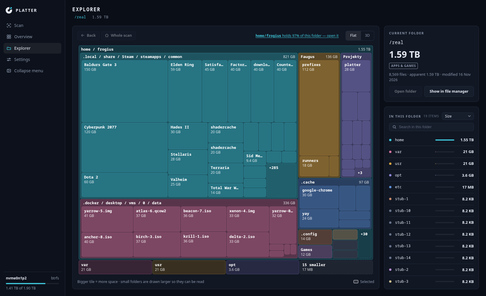
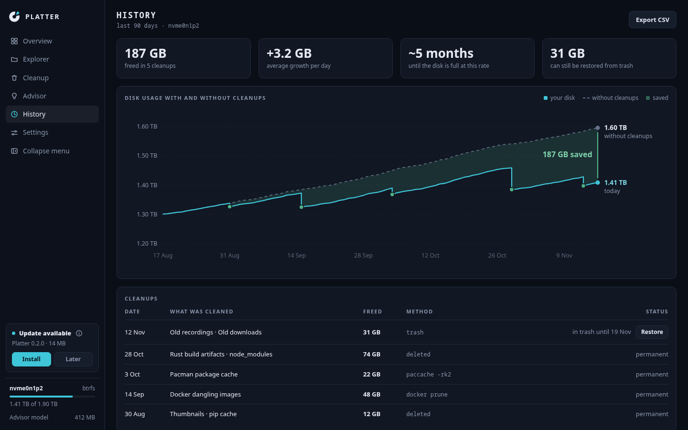
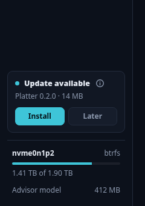

# Platter: what is built and what comes next

This is the hand-over for whoever continues the work. Read it top to bottom once, then pick one work package at a time from "Work packages". Each package is sized to be done, verified and committed on its own.

Other documents:

- `docs/architecture.md` is the binding contract (crates, ports, scanner rules, IPC types, suggestions). Change it first, then the code.
- `docs/mockups/` holds the HTML mockups the owner approved. They are the visual truth. Open them in a browser; do not copy their code wholesale.
- `docs/plan/screens/` holds screenshots: `target-*.png` is how a view must look (taken from the mockups), `built-*.png` is how the app looks today on mock data.

## 1. State today

Built and working (milestone 1 plus read-only suggestions):

| Area | What exists |
|---|---|
| Scanner | Parallel walker, hardlink dedupe, "same disk" mount rule (btrfs subvolumes included), memory budget, cancel, warnings. Matches `du -s -B1` exactly on real folders. |
| Queries | Children (paged, sorted), level-of-detail tree, path, summary (file types, age, largest folders), node flags `unreadable` and `skipped`. |
| Rules | `platter-rules`: read-only suggestions with verdict safe / review / keep. No code that deletes anything; a lint and a test enforce that. |
| Desktop app | Scan screen, scan progress, Overview (three columns as in the mockup, Advisor list without controls), Explorer (flat map, 3D columns, list with search), Settings (three working settings). |
| CLI | `platter-cli volumes`, `scan`, `suggest`, `export-fixture`. |
| CI | `.github/workflows/ci.yml`: Rust, web, dependency audit. Never run on GitHub yet. |

Screens as built (mock data):

| Scan | Overview |
|---|---|
|  |  |

| Explorer, flat | Explorer, 3D |
|---|---|
|  |  |

Checks at hand-over, all passing: 384 Rust tests, 540 frontend tests, clippy, rustfmt, eslint, prettier, svelte-check, cargo-deny.

### Known gaps (do these before or alongside new features)

1. **No independent review of the newest work.** The rules crate, the memory budget (`platter-core/src/budget.rs`), the reworked Explorer and Overview were built after the last full review. Work package R1 covers this. It must happen before any code that deletes files.
2. **Never verified in the real app window by a tool.** All screenshots come from headless Chrome on mock data. The app window uses WebKitGTK, which differs: it ignored the standard scrollbar CSS, did not reserve a scrollbar slot, and showed a focus ring after mouse clicks. The owner checks by eye. Items still unconfirmed by the owner: thin scrollbars, list right edge, 3D camera fit, window icon, focus ring.
3. **Mock and real backend differ in places.** The mock's `largestDirs` uses an older rule; the mock omits `skipped` and `sharedFiles`. Tests on the mock can pass while the real app shows something else.
4. **Scan warnings are not shown.** `finished.warnings` (`mountTableUnavailable`) reaches the frontend and is ignored.
5. **btrfs shared blocks.** A scan of `/` reports about 114 GB more than `df`, most likely snapshots and reflinks sharing extents. The UI does not say so.
6. **Trash totals with hard links.** A suggestion's size can differ from what deleting frees; `sharedFiles` carries the count but the UI does not show it.
7. **Leftovers.** `scripts/dev/desktop-entry.sh` installs a desktop entry for local builds; packaged builds need their own (package D1).

## 2. Rules that apply to every package

These come from the owner's feedback during design and the first build. Breaking them was the main cause of rework.

**Design**

- Match the mockup. If a feature is not built yet, leave its controls out; never show fake data or dead buttons. Do not rearrange an approved layout to fill a gap; ask.
- Flat styling: no gradients, no glows. One accent colour (`--accent`). Green means "safe" and nothing else.
- Cards in a row end at the same height. No empty space inside a card, and no stretching row spacing to fill one.
- One left edge and one right edge per card: titles, inputs, dots, numbers and separators line up. Measure it.
- No layout shift on hover, selection, or when a scrollbar appears.
- Confirmations are a `<dialog>`, never a button that turns into another button.
- Labels: cut names at the end, never in the middle; show a size in full or not at all.
- A folder has one colour everywhere (`apps/desktop/src/lib/folderColor.ts`): the largest child inherits its parent's colour, the others take the palette in order.

**Verification**

- Look at the result. Take headless screenshots and compare them with the mockup side by side; measure edges with PIL.
- Test with skewed data, not only the balanced mock. `?root=/real` is a mock shaped like a real disk (one folder holds 97%). Add scenarios like it for new views.
- Headless Chrome is not the app window. Do not rely on `scrollbar-gutter`, `scrollbar-width`, `scrollbar-color` or `:focus-visible` after a click. State plainly what was not checked in WebKitGTK.
- Screenshot command (zsh does not split unquoted variables, so write flags inline; the GL flags are required for the 3D view):

  ```
  google-chrome-stable --headless=new --use-gl=angle --use-angle=swiftshader --enable-unsafe-swiftshader \
    --hide-scrollbars --window-size=1640,1000 --virtual-time-budget=8000 \
    --screenshot=out.png "http://localhost:4173/?view=overview&static"
  ```

  URL hooks (ignored inside the app window): `view=start|scanning|overview|explorer|settings`, `static`, `mini`, `root=/real|/skew|/home/demo`, `dominant`, `mounts`, `ready`, `ex=flat|3d`, `focus=<id>`, `pick=<n>`.

**Safety**

- Never create large test trees on disk. An agent once used every inode of `/tmp` with millions of hard-linked files. Use the in-memory fake filesystem (`platter_core::testing::FakeFs`); keep real fixtures under a few thousand entries, and never under `/tmp` at scale.
- `unsafe_code = "forbid"` for the whole workspace. OS-specific code only in `platter-platform`.
- The web view has no Tauri permissions (`capabilities/default.json` is empty). It may never pass a path or URL to the backend; it names a node id from a scan.
- Signing keys for the updater are created by the owner, never by an agent.
- Commit or push only when the owner asks.

**Process**

- One package at a time. Workers on overlapping files conflict; split by folder (`features/overview`, `features/explorer`, `crates/…`).
- After each package run: `cargo fmt --all -- --check`, `cargo clippy --workspace --all-targets -- -D warnings`, `cargo test --workspace`, `cargo deny check`, and in `apps/desktop`: `pnpm lint`, `pnpm check`, `pnpm test`, `pnpm build`.
- Build and start the app: `pnpm -C apps/desktop tauri build --no-bundle`, then `target/release/platter`.

## 3. Order

1. R1 (reviews), F1–F4 (small fixes).
2. Cleanup: C1–C7. This is the point of the app.
3. Advisor model: A1–A4.
4. History: H1–H2.
5. Distribution and updates: D1–D4. Needs the owner's signing keys.
6. Settings completion: S1.
7. Windows and macOS: P1–P2.

The owner may reorder. Cleanup before Advisor is fixed, because the model only labels what the rules do not cover.

## 4. Work packages

### R1. Review the newest work (before any deleting code)

- **Scope:** read-only correctness review and security audit of `crates/platter-rules/**`, `crates/platter-core/src/budget.rs` and its callers, `crates/platter-platform/src/linux/{open,same_fs,snapshot}.rs`, `apps/desktop/src/lib/features/{explorer,overview}/**`, `apps/desktop/src/lib/folderColor.ts`, `scripts/dev/desktop-entry.sh`.
- **Focus for rules:** every way a name or layout can make something precious be labelled `safe` (a personal folder named `target` beside a `Cargo.toml`, `node_modules` beside a `package.json`, `~/.cache` holding things users put there, `HOME` set oddly, a scan root that is itself matched). Check that `Tree::shared_files` is correct (it relies on descendants at one depth forming one contiguous id run).
- **Done when:** findings are fixed or listed with a decision; no High finding open.

### F1. Show scan warnings and hard-link notes

- Show `finished.warnings` on the Overview as one muted line under the status pill ("Mounted disks could not be read, so only this disk's own files were counted").
- In the Advisor row, when `sharedFiles > 0`, add to the reason: "N files are also linked from elsewhere, so the space freed can differ."
- Files: `features/overview/**`, `state/scan.svelte.ts`. Tests on both.

### F2. Make the mock match the backend

- Port the current `largestDirs` rule (see `docs/architecture.md`) to `apps/desktop/src/lib/api/mock.ts`; add `skipped` to mock mount nodes and `sharedFiles` to mock suggestions.
- Better: generate the mock tree from a real `platter-cli export-fixture` run on a synthetic folder, so the two cannot drift. Never commit a fixture made from a real home folder (it contains private names).

### F3. Name filter in the backend

- `get_children` gains an optional `query` (case-insensitive substring on the name). The Explorer's search then works on any folder size; remove the 5,000-item cap and background page loading in `features/explorer/state/explorer.svelte.ts`.
- Contract change first. Tests in core (`query/children.rs`) and the store.

### F4. Explain shared space on btrfs

- When the scanned volume is btrfs and scanned bytes exceed the volume's used bytes, show one line on the Capacity card: "Some files share disk blocks (snapshots or copies), so folder sizes add up to more than the disk uses."
- No new measurement; compare `Totals.allocated` with `VolumeDto.total − available`.

---

### Cleanup

Target screens:

| Overview with controls | Review dialog |
|---|---|
|  |  |

| Cleanup, scanning | Cleanup, review |
|---|---|
|  |  |

Explorer with marking (target): 

Design decisions already made with the owner:

- The Cleanup view's left side is the **flow chart** (groups on the left, ribbons to "Will be freed" or "Stays on disk"); see `docs/mockups/c-orb.html`. The owner rejected an orbit, tiles, and a gauge with bars.
- The right panel reuses the Overview's Advisor list pattern: "Select Safe | All | None", grouped rows with a checkbox, reason always visible, total, status text, "Clean safe · X" and "Clean selected (n)".
- Items that need review open a `<dialog>` listing them before anything is cleaned.
- Caches and package data are deleted directly (trashing them frees nothing). The user's own files go to the trash first.
- Group headings in the Advisor list scroll with their rows; they do not stick.

#### C1. Cleanup plan and guard (backend, no deleting yet)

- New module in `platter-rules` or a new crate `platter-cleanup`: `CleanupAction = Trash | Delete | RunTool { program, args, needs_elevation }`, and `CleanupPlan` built from selected suggestion ids. A plan records for each target `(dev, ino, size, mtime)` from the scan.
- `VerifiedTarget`: a type only the guard can construct. The guard rejects: the scan root, `/`, the home directory, mount roots, anything outside the scan root, anything whose verdict is `keep`, anything matched by a deny-list of paths (`~/.ssh`, `~/.gnupg`, `~/Documents`, `~/Pictures`, …), symlinks, and unreadable nodes. Compare canonical paths component by component.
- Dry run: returns what would be removed and how much, without touching disk.
- Tests on the fake filesystem for every rejection. Property test: no plan can contain a path outside the scan root.
- **Done when:** `platter-cli clean <path> --dry-run` prints a plan and nothing on disk changes.

#### C2. Guarded execution (backend)

- Execute accepts only `VerifiedTarget`s, re-verified at execute time: open the parent directory by descriptor, `statx` the entry with `AT_SYMLINK_NOFOLLOW`, compare `(dev, ino)` with the plan, then `unlinkat`. Recursive deletes walk by descriptor, never by path string. Reuse `platter-platform/src/linux/open.rs`.
- Trash: implement the freedesktop trash spec in `platter-platform` (same-filesystem trash directory, `.trashinfo`), or use the `trash` crate after checking it does not follow symlinks.
- A hard-linked file frees nothing unless every link is in the plan; report freed bytes from before/after `statvfs`, not from the plan.
- Progress events per group; cancel between targets, never mid-target.
- Tests: swap a directory for a symlink between plan and execute (must refuse); delete a tree with a mount inside (must stop at the mount); permission errors are reported per target and do not abort the run.
- **Done when:** the CLI can clean a temp tree and the test suite proves the refusals.

#### C3. Owning tools and elevation

- Package caches and logs are cleaned by their own tool: `paccache -rk2`, `apt-get clean`, `dnf clean packages`, `journalctl --vacuum-time=2weeks`, `docker system prune`. Each is a `RunTool` with fixed arguments; the UI never supplies arguments.
- Elevation port in `platter-platform`: `pkexec` with a shipped polkit policy on Linux. One prompt per run.
- **Done when:** a system-cache cleanup works on the owner's machine through the system password prompt, and a refused prompt is reported cleanly.

#### C4. IPC and state

- Commands: `plan_cleanup(scan, suggestion_ids) → CleanupPlanDto`, `start_cleanup(plan_id, onEvent) → CleanupId`, `cancel_cleanup`, `undo_cleanup(cleanup_id)` (restores from trash where possible).
- After a cleanup the tree is stale: either rescan the affected subtrees or mark the scan as outdated and offer "Rescan". Decide and write it into the contract.
- The web view still passes only ids.

#### C5. Overview controls

- Add to the Advisor card: checkboxes (safe pre-ticked), "Select Safe | All | None", footer with "Clean safe · X" and "Clean selected (n)", status text ("Includes 2 review items (310 GB). You will confirm them first."), and the review `<dialog>`.
- Add the "Already freed" row to the Reclaimable card.
- Pixel rules from the mockup: checkbox, title, path and reason start on one vertical line; the segmented "Select" control is not clipped on the right; the status text is vertically centred against the total.
- Compare against `screens/target-overview.png` and `target-overview-confirm.png`.

#### C6. Cleanup view

- New nav item "Cleanup" between Explorer and Settings.
- Three steps in a bar exactly as wide as the right panel: Scan, Review, Clean. Step numbers centred in their circles.
- Review step: hero numbers ("Selected to free", "Disk after cleanup"), the flow chart drawn at the card's pixel size, the right panel from C5.
- Clean step: ribbons turn solid one by one; then a result panel with before/after bars, Undo and "Scan again".
- Port the flow layout from `docs/mockups/c-orb.html` (`drawFlow`) into a pure module with tests; thin groups get a minimum height so they can be read and clicked.

#### C7. Mark for cleanup in the Explorer

- Details card: "Mark for cleanup" beside "Open folder" (both always present, disabled when not applicable, so the card never changes height).
- List rows: a checkbox, or a lock icon with "KEPT" for items a rule keeps.
- Footer under the list: "Marked for cleanup", total, "Clean (n)", same review dialog.
- A marked folder shows a dashed outline on the map; the legend gains "Marked for cleanup" and "Safe to clean" (green outline with a SAFE tag on the topmost fully safe folder).
- Marking an arbitrary folder is not covered by a rule: its verdict is `review` and it always goes through the dialog and the trash.

---

### Advisor model

Target: 

#### A1. Model runtime (backend)

- New crate `platter-ai` behind a cargo feature. `llama-cpp-2` with a 0.5B instruct model at Q4_K_M (Qwen2.5-0.5B-Instruct class, Apache-2.0; avoid Llama- and Gemma-licensed models). About 400 MB on disk.
- Explicit opt-in download with a pinned SHA-256; this and the update check are the only network calls and both are disclosed in the UI.
- Load on demand, unload after idle; report RAM use.

#### A2. Labelling

- Input per folder: path pattern, aggregate metadata (size, file count, age, categories), never file contents.
- Output forced to JSON by a grammar: verdict and one sentence.
- The model labels only folders no rule matched, and can never change a `keep`. Its output goes through the same guard as rules; a model label alone is always `review`, never `safe`.

#### A3. Advisor view

- Model card (load/unload, size, RAM), "How a verdict is made" (three connected steps with counts from the last scan), "What the model can see", "Ask about a folder" (user message right in the accent tint, advisor answer left with an icon and a verdict line), "Needs your input", "Your rules" with an add form.
- The Overview's Advisor tag changes from `RULES` to `LOCAL MODEL` only while the model is loaded.

#### A4. User rules

- Rules the user adds ("always keep ~/Videos", "~/tmp is safe") stored as data next to the built-in table, in the app's config directory. They take precedence over the model, never over the deny-list.

---

### History

Target: 

#### H1. Scan and cleanup log (backend)

- A small local store (SQLite or a JSON-lines file in the app's data directory): each scan's totals and each cleanup's items, freed bytes, method, and whether it can still be restored.

#### H2. History view

- Four stat tiles; the chart "Disk usage with and without cleanups" (solid line for real usage, dashed for "without cleanups", the gap shaded and labelled "N GB saved"); the cleanups table with Restore.
- The chart needs daily usage: record one sample per day while the app is open, and say so when the data is thin.

---

### Distribution and updates

Target: 

#### D1. Packages

- `.github/workflows/release.yml` on a version tag: AppImage, deb, rpm via `tauri build`, with `SHA256SUMS`. The desktop entry and icons come from the bundler; check the window's app id matches the desktop file name, or the taskbar shows a generic icon on Wayland.
- AUR `platter-bin` is the first distribution channel after GitHub Releases. Flathub later (sandbox limits scanning).

#### D2. Install script

- `install.sh`: download, verify against `SHA256SUMS`, install to `~/.local`, add the desktop entry.

#### D3. Updater

- Needs signing keys created and stored by the owner. Tauri's updater only updates AppImages; deb and rpm installs get a notice only.
- Periodic check at start and on an interval (Settings: every 6 hours, daily, weekly, never).
- The sidebar component `components/layout/UpdateNotice.svelte` exists and is hidden until an update object is supplied: title "Update available" with an (i) tooltip listing what is new, version and size, "Install" and "Later"; Install shows a progress bar, then "Restart to finish". Collapsed sidebar: a download icon with a dot.

#### D4. First CI run

- Push a branch and fix whatever the three CI jobs report. The workflow has only been checked with `actionlint`.

---

### Settings

Target: 

#### S1. Complete Settings as features land

- Add a card only when its feature works: Cleanup (trash first, empty Platter's trash after N days, confirm review items, keep N package versions, ask for administrator rights), Advisor (use the local model, model choice, unload after), Updates (version, check now, install automatically, channel, check interval), Appearance (theme), Scanning (excluded paths, volumes).
- Dropdowns use the app's own `Dropdown` (button as wide as its widest option, menu the same width, never clipped under the next card).

---

### Other platforms

#### P1. Windows

- Add `x86_64-pc-windows-msvc` to CI. The generic reader already works; write a fast reader (`FindFirstFileExW`, later the MFT) in `platter-platform/src/windows/`, default exclusions, volume listing, elevation through UAC, the recycle bin.

#### P2. macOS

- Fast reader with `getattrlistbulk`, firmlink exclusions (`/System/Volumes/Data` is otherwise counted twice), trash, authorization, an `.icns` icon (not generated yet).

## 5. Where things are

```
crates/platter-core       model (tree, categories), scan (walker, budget, assemble), query, dto, ports, testing/fake_fs
crates/platter-platform   linux/ (reader, mounts, same_fs, open, budget), generic/, volumes, labels, memory, root, environment
crates/platter-rules      rule table, matchers, evaluation (read-only)
crates/platter-cli        volumes, scan, suggest, export-fixture; format.rs escapes all terminal output
apps/desktop/src-tauri    commands/{volumes,scan,query,suggestions,system}, state (scan registry), capabilities
apps/desktop/src/lib
  api/                    types.ts (mirror of the contract), client.ts, tauri.ts, mock*.ts
  state/                  scan, settings, ui, navigation
  components/ui|layout    Button, Card, Dropdown, Dialog, Toast, Tooltip, Spinner, Sidebar, UpdateNotice, PageBoundary
  features/start|scan|overview|explorer|settings
  folderColor.ts, palette.ts, categories.ts, format.ts, hooks.ts
```
