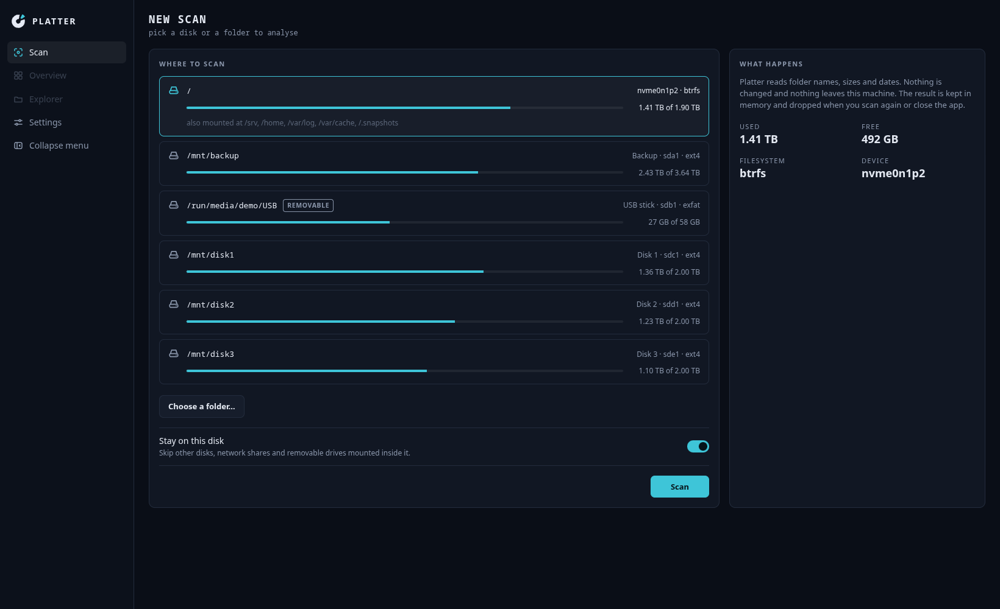
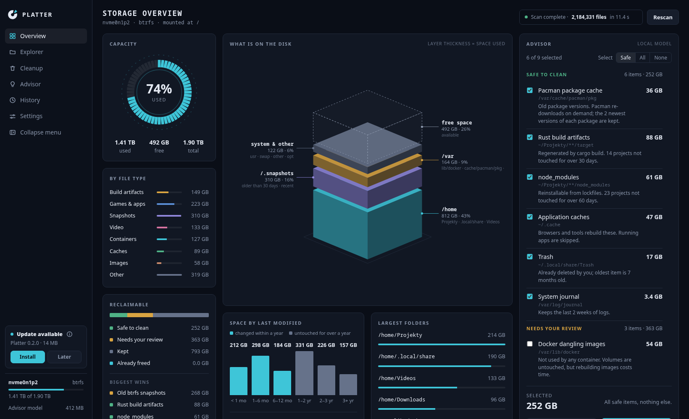
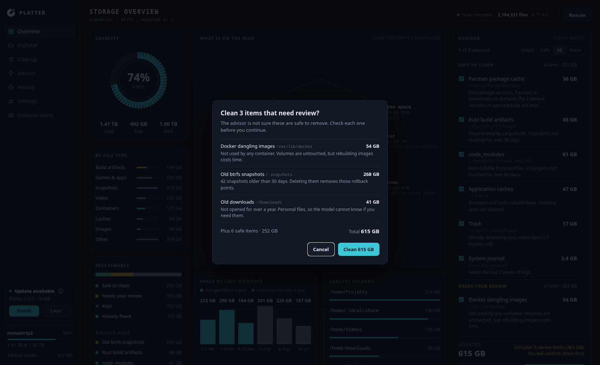
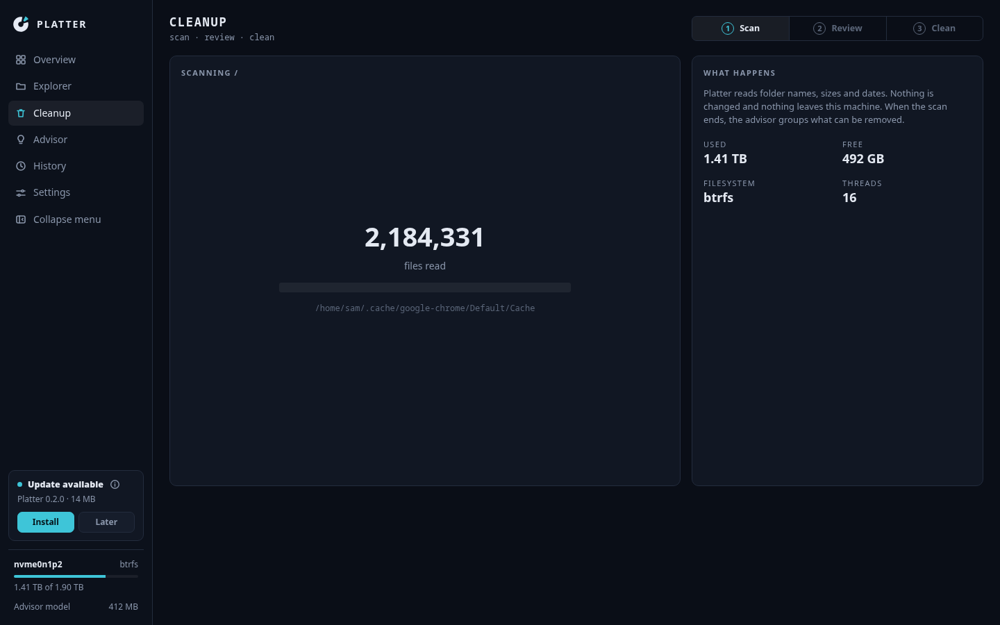
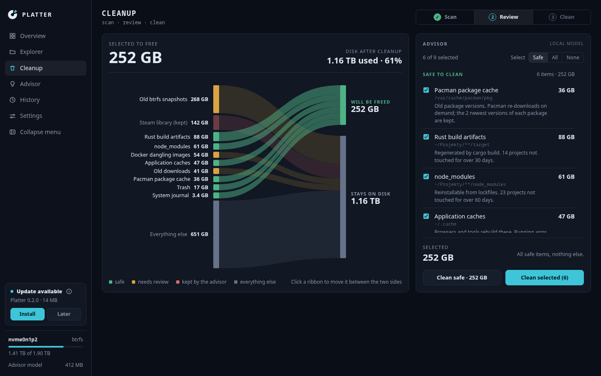
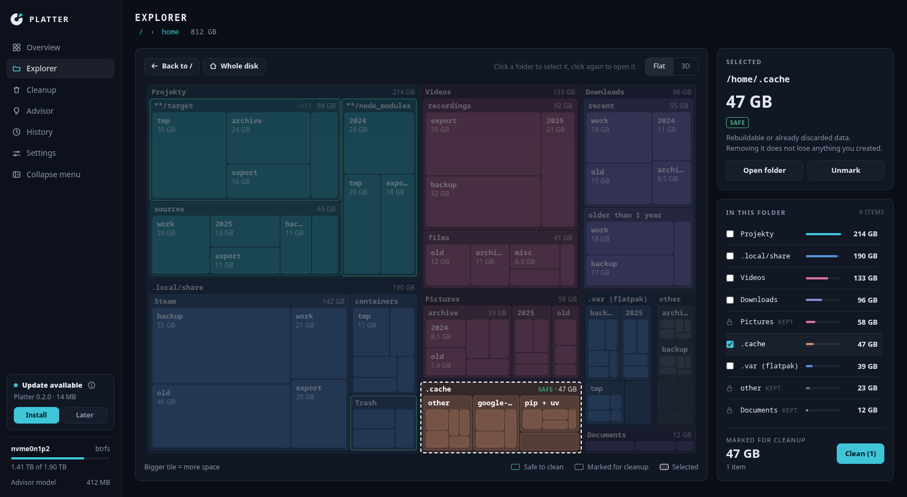

# Platter: what is built and what comes next

This is the hand-over for whoever continues the work. Read it top to bottom once, then pick one work package at a time from "Work packages". Each package is sized to be done, verified and committed on its own.

Other documents:

- `docs/architecture.md` is the binding contract (crates, ports, scanner rules, IPC types, suggestions). Change it first, then the code.
- `docs/mockups/` holds the HTML mockups the owner approved. They are the visual truth. Open them in a browser; do not copy their code wholesale.
- `docs/plan/screens/` holds screenshots: `target-*.png` is how a view must look (taken from the mockups), `built-*.png` is how the app looks today on mock data.

## 1. State today

Built and working (milestone 1, suggestions, and cleanup C1–C7):

| Area | What exists |
|---|---|
| Scanner | Parallel walker, hardlink dedupe, "same disk" mount rule (btrfs subvolumes included), memory budget, cancel, warnings. Matches `du -s -B1` exactly on real folders. |
| Queries | Children (paged, sorted), level-of-detail tree, path, summary (file types, age, largest folders), node flags `unreadable` and `skipped`. |
| Rules | `platter-rules`: read-only suggestions with verdict safe / review / keep. Rules never delete; deleting lives only in `platter-cleanup`. |
| Cleanup | `platter-cleanup`: plan, guard, guarded delete and trash, owning tools with `pkexec`, undo from the trash. Desktop: Overview controls, Cleanup view (flow chart), marking in the Explorer, native confirmation. |
| Desktop app | Scan screen, scan progress, Overview (three columns as in the mockup, Advisor list with cleanup controls), Cleanup view, Explorer (flat map, 3D columns, list with search, marking), Settings (three working settings). |
| CLI | `platter-cli volumes`, `scan`, `suggest`, `clean --dry-run / --yes`, `export-fixture`. |
| CI | `.github/workflows/ci.yml`: Rust, web, dependency audit. Never run on GitHub yet. |

Screens as built (mock data):

| Scan | Overview |
|---|---|
|  |  |

| Explorer, flat | Explorer, 3D |
|---|---|
|  |  |

Checks on 2026-11-16 (after the Advisor model), all passing: 882 Rust tests (3 ignored real-model tests), 1244 frontend tests, clippy, rustfmt, eslint, prettier, svelte-check, cargo-deny.

### Known gaps (do these before or alongside new features)

1. **R1 is done; its fixes were not re-reviewed.** The review found one High (name rules labelled tools' `node_modules` and localised personal folders `safe`) and eight Medium findings. The rules, Explorer and CLI findings were fixed on 2026-11-16; the owner chose to skip a fresh review of those fixes and move on. Two Medium findings are not fixed in code but written into C1 and C4 below as requirements (mount roots and file identity are not in the tree; the web view chooses the scan root). Open Low findings are listed under R1.
2. **Never verified in the real app window by a tool.** All screenshots come from headless Chrome on mock data. The app window uses WebKitGTK, which differs: it ignored the standard scrollbar CSS, did not reserve a scrollbar slot, and showed a focus ring after mouse clicks. The owner checks by eye. Items still unconfirmed by the owner: thin scrollbars, list right edge, 3D camera fit, window icon, focus ring.
3. **Mock and real backend differ in places.** The mock's `largestDirs` uses an older rule; the mock omits `skipped` and `sharedFiles`. Tests on the mock can pass while the real app shows something else.
4. **Scan warnings are not shown.** `finished.warnings` (`mountTableUnavailable`) reaches the frontend and is ignored.
5. **btrfs shared blocks.** A scan of `/` reports about 114 GB more than `df`, most likely snapshots and reflinks sharing extents. The UI does not say so.
6. **Trash totals with hard links.** A suggestion's size can differ from what deleting frees; `sharedFiles` carries the count but the UI does not show it.
7. **Leftovers.** `scripts/dev/desktop-entry.sh` installs a desktop entry for local builds; packaged builds need their own (package D1).

## 2. Rules that apply to every package

These come from the owner's feedback during design and the first build. Breaking them was the main cause of rework.

**Design**

- Match the mockup. If a feature is not built yet, leave its controls out; never show fake data or dead buttons. Do not rearrange an approved layout to fill a gap; ask.
- Flat styling: no gradients, no glows. One accent colour (`--accent`). Green means "safe", and "freed" (what safe and chosen items free; owner decision 2026-11-16); nothing else.
- Cards in a row end at the same height. No empty space inside a card, and no stretching row spacing to fill one.
- One left edge and one right edge per card: titles, inputs, dots, numbers and separators line up. Measure it.
- No layout shift on hover, selection, or when a scrollbar appears.
- Confirmations are a `<dialog>`, never a button that turns into another button.
- Labels: cut names at the end, never in the middle; show a size in full or not at all.
- A folder has one colour everywhere (`apps/desktop/src/lib/folderColor.ts`): the largest child inherits its parent's colour, the others take the palette in order.

**Verification**

- Look at the result. Take headless screenshots and compare them with the mockup side by side; measure edges with PIL.
- Test with skewed data, not only the balanced mock. `?root=/real` is a mock shaped like a real disk (one folder holds 97%). Add scenarios like it for new views.
- Headless Chrome is not the app window. Do not rely on `scrollbar-gutter`, `scrollbar-width`, `scrollbar-color` or `:focus-visible` after a click. State plainly what was not checked in WebKitGTK.
- Screenshot command (zsh does not split unquoted variables, so write flags inline; the GL flags are required for the 3D view):

  ```
  google-chrome-stable --headless=new --use-gl=angle --use-angle=swiftshader --enable-unsafe-swiftshader \
    --hide-scrollbars --window-size=1640,1000 --virtual-time-budget=8000 \
    --screenshot=out.png "http://localhost:4173/?view=overview&static"
  ```

  URL hooks (ignored inside the app window): `view=start|scanning|overview|explorer|settings`, `static`, `mini`, `root=/real|/skew|/home/demo`, `dominant`, `mounts`, `ready`, `ex=flat|3d`, `focus=<id>`, `pick=<n>`, `gpu=fallback|none` (the advisor's graphics card failed, or a build without one), `gpuProblem=crash|hang|error` (a graphics card incident waiting for an answer at start: the dialog), `gpuLast=1` (an answered last problem: the row in Settings).

**Safety**

- Never create large test trees on disk. An agent once used every inode of `/tmp` with millions of hard-linked files. Use the in-memory fake filesystem (`platter_core::testing::FakeFs`); keep real fixtures under a few thousand entries, and never under `/tmp` at scale.
- `unsafe_code = "forbid"` for the whole workspace. OS-specific code only in `platter-platform`.
- The web view has no Tauri permissions (`capabilities/default.json` is empty). It may never pass a path or URL to the backend; it names a node id from a scan.
- Signing keys for the updater are created by the owner, never by an agent.
- Commit or push only when the owner asks.

**Process**

- One package at a time. Workers on overlapping files conflict; split by folder (`features/overview`, `features/explorer`, `crates/…`).
- After each package run: `cargo fmt --all -- --check`, `cargo clippy --workspace --all-targets -- -D warnings`, `cargo test --workspace`, `cargo deny check`, and in `apps/desktop`: `pnpm lint`, `pnpm check`, `pnpm test`, `pnpm build`.
- Build and start the app: `pnpm -C apps/desktop tauri build --no-bundle`, then `target/release/platter`.

## 3. Order

1. ~~R1 (reviews), F1–F4 (small fixes).~~ Done.
2. ~~Cleanup: C1–C7. This is the point of the app.~~ Done 2026-11-16 (owner checks in WebKitGTK ongoing).
3. ~~Advisor model: A1–A4.~~ Done 2026-11-16 (owner checks in WebKitGTK and the real download open).
4. **Current:** Advisor A5 (free questions about the scan; one model, the 4B). Done 2026-11-16, backend and frontend: A5.0, A5.1, A5.3, A5.4, A5.5, A5.6 (outcome: A5.7), A5.7, A5.8, A5.9, A5.10, A5.11. Open: the final correctness and security review of the facts-only flow (skipped by the owner before committing) and the owner's check in the app window.
5. **Current:** Advisor on the graphics card: G1–G4. G1–G3 built and reviewed 2026-11-17; G4 (the model in a helper process, answering the open driver-fault decision) built 2026-11-17, reviews pending.
6. History: H1–H2.
7. Distribution and updates: D1–D4. Needs the owner's signing keys.
8. Settings completion: S1.
9. Windows and macOS: P1–P2.

The owner may reorder. Cleanup before Advisor is fixed, because the model only labels what the rules do not cover.

## 4. Work packages

### R1. Review the newest work (before any deleting code)

- **Scope:** read-only correctness review and security audit of `crates/platter-rules/**`, `crates/platter-core/src/budget.rs` and its callers, `crates/platter-platform/src/linux/{open,same_fs,snapshot}.rs`, `apps/desktop/src/lib/features/{explorer,overview}/**`, `apps/desktop/src/lib/folderColor.ts`, `scripts/dev/desktop-entry.sh`.
- **Focus for rules:** every way a name or layout can make something precious be labelled `safe` (a personal folder named `target` beside a `Cargo.toml`, `node_modules` beside a `package.json`, `~/.cache` holding things users put there, `HOME` set oddly, a scan root that is itself matched). Check that `Tree::shared_files` is correct (it relies on descendants at one depth forming one contiguous id run).
- **Done when:** findings are fixed or listed with a decision; no High finding open.

- **Status (2026-11-16):** done. Fixed: `keep` wins over every rule and is never entered; a scan inside a kept folder suggests nothing; personal folders come from XDG `user-dirs.dirs` (Desktop, Documents, Music, Pictures, Videos under any name); without a known home, name rules are at most `review`; a folder with an unreadable part is never `safe`; `node_modules` needs a lockfile and is never matched inside tools' folders (`.nvm`, `.vscode*`, `.cursor*`, `node_modules`, ...) or below `/usr` and `/opt`; markers must be regular files; `~/.cache`, `~/.m2/repository`, the journal and the pacman cache are `review`; `HOME=/` counts as unknown; the CLI pins the scan root's identity; `desktop-entry.sh` quotes `Exec=` and refuses unsafe paths; Explorer: the "smaller items" tile stops loading at 5,000 rows, a chain tile's details, Open and Reveal all describe its last folder, zero-size rows are never hidden.
- **Open Low findings:** a name-limit hit is reported as a memory limit (`scan/mod.rs`, needs a `ScanLimit` variant); the memory budget is per scan, not per process, and blocking queries are not bounded; the read-only check of `platter-rules` can be bypassed (`build.rs`, aliases, `#[allow]`); the scan root itself can be claimed by a fixed or home rule (C1 refuses the scan root); folder colour below depth 12 differs between navigating and a deep link; 3D view rebuilds the scene when a colour arrives late; percentages round 99.6% up to "100%"; the disk stack can be clipped at the top on btrfs; smaller list and search issues; stale Explorer id when `openInExplorer` runs during a rescan; a pnpm workspace's member packages have no lockfile next to them, so their `node_modules` are no longer suggested.

### F1. Show scan warnings and hard-link notes

- Show `finished.warnings` on the Overview as one muted line under the status pill ("Mounted disks could not be read, so only this disk's own files were counted").
- In the Advisor row, when `sharedFiles > 0`, add to the reason: "N files are also linked from elsewhere, so the space freed can differ."
- Files: `features/overview/**`, `state/scan.svelte.ts`. Tests on both.
- **Status (2026-11-16):** done. `ReadyScan.warnings`, `features/overview/scanWarnings.ts`, `advisor.ts` `reasonOf`. Mock hook `?warn` shows the line. Not checked in the WebKitGTK window.

### F2. Make the mock match the backend

- Port the current `largestDirs` rule (see `docs/architecture.md`) to `apps/desktop/src/lib/api/mock.ts`; add `skipped` to mock mount nodes and `sharedFiles` to mock suggestions.
- Better: generate the mock tree from a real `platter-cli export-fixture` run on a synthetic folder, so the two cannot drift. Never commit a fixture made from a real home folder (it contains private names).
- **Status (2026-11-16):** done by porting, not by fixture: `mock-summary.ts` (`largestDirs`), `mock-lod.ts` (heap admission as `query/lod.rs`), `mock-dto.ts` (`unreadable`, `skipped`), `mock-suggestions.ts` (the full rule table and `evaluate.rs` behaviour, with `sharedFiles`). Still different: directory categories from names, file categories from extensions, hard-link accounting, XDG folder names, `totals.errors`/`dirs` of the finished event, non-ASCII names. Backend questions it raised: on a real-shaped disk Largest folders shows one huge folder then tiny ones (`stub-1`…); LOD stops one item early when the last sibling would replace the placeholder; a collapsed node of only empty items gets category `video`; the `disk-images` reason says "1 GiB" whatever unit is set.

### F3. Name filter in the backend

- `get_children` gains an optional `query` (case-insensitive substring on the name). The Explorer's search then works on any folder size; remove the 5,000-item cap and background page loading in `features/explorer/state/explorer.svelte.ts`.
- Contract change first. Tests in core (`query/children.rs`) and the store.
- **Status (2026-11-16):** done. Backend: `query::NameFilter`, `children_matching`, `get_children` `query` (max 1024 bytes). Frontend: the store asks the backend after a 150 ms pause and drops stale answers; the search cap and background loading are gone (the 5,000 cap remains only for the "smaller items" tile); the search box takes at most 255 characters. Header counts are sized items on both sides ("12 of 143 items"). Not checked in the WebKitGTK window.

### F4. Explain shared space on btrfs

- When the scanned volume is btrfs and scanned bytes exceed the volume's used bytes, show one line on the Capacity card: "Some files share disk blocks (snapshots or copies), so folder sizes add up to more than the disk uses."
- No new measurement; compare `Totals.allocated` with `VolumeDto.total − available`.
- **Status (2026-11-16):** done in `CapacityCard.svelte` with tests; no screenshot, because the mock never scans more than the disk uses.

---

### Cleanup

Target screens:

| Overview with controls | Review dialog |
|---|---|
|  |  |

| Cleanup, scanning | Cleanup, review |
|---|---|
|  |  |

Explorer with marking (target): 

Design decisions already made with the owner:

- The Cleanup view's left side is the **flow chart** (groups on the left, ribbons to "Will be freed" or "Stays on disk"); see `docs/mockups/c-orb.html`. The owner rejected an orbit, tiles, and a gauge with bars.
- The right panel reuses the Overview's Advisor list pattern: "Select Safe | All | None", grouped rows with a checkbox, reason always visible, total, status text, "Clean safe · X" and "Clean selected (n)".
- Items that need review open a `<dialog>` listing them before anything is cleaned.
- Caches and package data are deleted directly (trashing them frees nothing). The user's own files go to the trash first.
- Group headings in the Advisor list scroll with their rows; they do not stick.

#### C1. Cleanup plan and guard (backend, no deleting yet)

- New module in `platter-rules` or a new crate `platter-cleanup`: `CleanupAction = Trash | Delete | RunTool { program, args, needs_elevation }`, and `CleanupPlan` built from selected suggestion ids. A plan records for each target `(dev, ino, size, mtime)` from the scan.
- `VerifiedTarget`: a type only the guard can construct. The guard rejects: the scan root, `/`, the home directory, mount roots, anything outside the scan root, anything whose verdict is `keep`, anything matched by a deny-list of paths (`~/.ssh`, `~/.gnupg`, `~/Documents`, `~/Pictures`, …), symlinks, and unreadable nodes. Compare canonical paths component by component.
- Dry run: returns what would be removed and how much, without touching disk.
- **From the R1 review, the guard must not assume from the tree:** (1) identity: the tree records no device, inode or mount id per node and not the root's identity, so `(dev, ino)` for a plan has to come from `statx` by descriptor at plan time; (2) mounts: a `Dir` node can be a mount the scan entered (a btrfs subvolume or a bind mount, possibly of data from outside the scan root), so check `STATX_ATTR_MOUNT_ROOT` and the mount id at every level, also while recursing; (3) paths: `SuggestionDto.path` is a display glob and `get_path` is lossy, only `path_bytes` is exact; (4) `SuggestionDto.nodes` holds at most 20 nodes, re-evaluate to get every match; (5) sizes: `allocated` is not what deleting frees (hard links, reflinks, snapshots); (6) freshness: the tree is a snapshot, so re-check each target and its rule right before acting; (7) the deny-list compares the canonical home and the XDG personal folders by identity, not by text. Put this code in a separate `platter-cleanup` crate, not in the read-only `platter-rules`.
- Tests on the fake filesystem for every rejection. Property test: no plan can contain a path outside the scan root.
- **Done when:** `platter-cli clean <path> --dry-run` prints a plan and nothing on disk changes.
- **Status (2026-11-16):** done. New crate `crates/platter-cleanup` (`action.rs`, `protect.rs`, `guard.rs`, `plan.rs`); port `EntryProbe` in core with `LinuxEntryProbe` (`platter-platform/src/linux/probe.rs`) and a `FakeFs` implementation (plus `swap_for_symlink` and `remove` to change the fake after a scan); `platter_rules::matches` gives every match. Tests: one per refusal (`tests/guard.rs`), a seeded property test over 400 random trees with links, mounts and unreadable folders (`tests/property.rs`), the Linux probe on real temp files, and `platter-cli clean` on a temp home (`crates/platter-cli/tests/clean.rs`). Not done here: the deny-list compares paths, not identities (point 7 above); elevation is only recorded per tool, not detected per path (C3); `go-modules` files are read-only and the Trash folder is emptied whole (`files/` and `info/` go too): C2 has to handle both.

#### C2. Guarded execution (backend)

- Execute accepts only `VerifiedTarget`s, re-verified at execute time: open the parent directory by descriptor, `statx` the entry with `AT_SYMLINK_NOFOLLOW`, compare `(dev, ino)` with the plan, then `unlinkat`. Recursive deletes walk by descriptor, never by path string. Reuse `platter-platform/src/linux/open.rs`.
- Trash: implement the freedesktop trash spec in `platter-platform` (same-filesystem trash directory, `.trashinfo`), or use the `trash` crate after checking it does not follow symlinks.
- A hard-linked file frees nothing unless every link is in the plan; report freed bytes from before/after `statvfs`, not from the plan.
- Progress events per group; cancel between targets, never mid-target.
- Tests: swap a directory for a symlink between plan and execute (must refuse); delete a tree with a mount inside (must stop at the mount); permission errors are reported per target and do not abort the run.
- **Done when:** the CLI can clean a temp tree and the test suite proves the refusals.
- **Status (2026-11-16):** done. Port `EntryRemover` (core), `LinuxEntryRemover` (`platter-platform/src/linux/remove.rs`) and the freedesktop trash (`linux/trash.rs`), `platter_cleanup::execute`, `platter-cli clean --yes`. Tests on real temp folders (`platter-platform/tests/remove.rs`): a link inside is removed, not followed; a folder or a folder on the way swapped for a link after the plan is refused and nothing is touched; another folder under the same name is refused; read-only folders are emptied; an unreadable folder inside is reported and the rest removed; a mount on the way (`/proc`) is refused; a tmpfs mounted inside the folder is left alone (run in an unprivileged user and mount namespace, skipped where those are not available); trashing writes the record and picks a free name. Runner tests with a recording remover (`platter-cleanup/tests/execute.rs`); CLI test cleaning a temp home. Follow-ups done the same day: an entry on another disk goes to that disk's `.Trash-$uid` (owner and mode checked; tested in a namespace with a tmpfs); `DeletionDate` is local time (`platter_platform::localtime`, TZif and POSIX footer rules); emptying the trash keeps `files/`, `info/` and `expunged/` and drops `directorysizes`; system caches go through their tools (C3). Still not done: the shared `$topdir/.Trash/$uid` is not used; the `directorysizes` cache is not updated when Platter trashes something.

#### C3. Owning tools and elevation

- Package caches and logs are cleaned by their own tool: `paccache -rk2`, `apt-get clean`, `dnf clean packages`, `journalctl --vacuum-time=2weeks`, `docker system prune`. Each is a `RunTool` with fixed arguments; the UI never supplies arguments.
- Elevation port in `platter-platform`: `pkexec` with a shipped polkit policy on Linux. One prompt per run.
- **Done when:** a system-cache cleanup works on the owner's machine through the system password prompt, and a refused prompt is reported cleanly.
- **Reviews (2026-11-16):** an independent correctness review and a security audit of C1–C3: no High finding. Fixed: protected places compared by identity as well (Medium; a bind mount of the home got past them); freshness re-checked for files (time and length) and project markers, at plan time and before acting (Medium; contract point 6); trash parts must sit in the planned trash folder; `fchmod` only on `EACCES`, adding owner bits and restoring the mode; the time-zone reader cannot overflow, falls back to its table, reads only regular files without blocking, accepts `TZ` rules; a missing `pkexec` and a tool's own 126/127 are no longer "password not given"; Docker is pinned to the local daemon; the runner executes the canonical program path with every ancestor checked; `Tool` and the plan's root are sealed; the home trash must belong to the user; long names fit in the trash; the CLI's exit code and wording (mounts left alone, nothing cleaned, a named rule found nothing, trash-only runs); cancel still closes its group; both free-space readings are taken after `syncfs`; a malformed scan root path is reported as such; the deny-list gained `~/.var`, `~/snap`, `~/.aws`, `~/.kube`, `~/.netrc`, `~/.git-credentials` and `~/.local/share/kwalletd`. A second, scoped review of the repairs confirmed them and found one more Medium (a protected place reached through a link, such as a dotfiles `~/.config`, was not protected): fixed, the place is now protected where it really is (`EntryProbe::resolve`, used only for protected places), with a test from both scan roots; folders above the home are now known by identity too; `syncfs` runs only on btrfs. The open points were then closed (2026-11-16): every look at the disk during planning has a 3 s limit (`TimedEntryProbe`), so an automount or a dead network share cannot stall it; trashing inside a nested btrfs subvolume uses that subvolume's `.Trash-$uid` (tested on a real subvolume); folders are emptied in batches of 1024 names, read again until a pass removes nothing, with at most 100 problems kept in detail (`Removed::note`, `more_errors`); `Platform::environment_for(scan_root)` treats a second path to the home or a personal folder (bind mount) as that folder, so suggestions label it `keep` too (tested in a namespace). Not done: the shared `$topdir/.Trash/$uid` is not used; a thread stuck in a hung lookup stays stuck (it cannot be interrupted), the plan just stops waiting for it.
- **Status (2026-11-16):** built, not yet checked on the owner's machine. Port `ToolRunner` (core), `LinuxToolRunner` (`platter-platform/src/linux/tools.rs`): programs only from root-owned system folders, cleared environment, `pkexec` for elevated tools, 126/127 = password not given. The runner stops prompting after one refusal. Core dumps use a fixed elevated `find ... -xdev -mindepth 1 -delete`. Not done: one prompt per run needs a shipped polkit policy and helper (packaging, D1); today each elevated tool asks. **Owner check (2026-11-16): passed.** `platter-cli clean /var/cache --rule pacman-cache --yes` with the password: `paccache -rk2` ran (cache 13.8 GiB to 11 GiB); with the prompt dismissed: "the administrator password was not given", exit code 1. That run showed "Free space grew by 0 B": btrfs frees deleted space only at its next commit, so the runner now calls `syncfs` before measuring (checked: a 286 MiB build folder on btrfs reports 286 MiB freed), and a 0 after a successful clean is worded as "not changed yet". The plan used to refuse the pacman cache because pacman's `download-*` folders are root-only; a part Platter cannot read no longer blocks a rule its tool cleans.

#### C4. IPC and state

- **Status (2026-11-16):** backend done. `apps/desktop/src-tauri/src/commands/cleanup.rs`: `plan_cleanup`, `start_cleanup`, `cancel_cleanup`, `undo_cleanup`; `CleanupRegistry` (plans by id, single use, 10 min, at most 4; one run at a time; last 4 runs kept for undo); native confirmation (`NativeConfirm`, `tauri-plugin-dialog`, set in `setup`; `RefuseAll` until then and in tests) built from the backend plan, for every plan (see Reviews below); scans outdated after any run (`ScanRegistry::disk_changed`); `start_scan` refuses roots the backend did not offer (`AppState::allow_roots` from `list_volumes` and `pick_folder`); `EntryRemover::restore` and `platter_cleanup::undo` for undo. Tests: plan validation and description, declined confirmation, an approved run with its events on a real temp folder, outdated scans, one run at a time, undo once, the confirmation text, the root allowlist over IPC. Frontend: `types.ts`, `client.ts` (`planCleanup`, `startCleanup`, `cancelCleanup`, `undoCleanup`), `tauri.ts`, `index.ts`, `mock-cleanup.ts` (same validation, single use, one run at a time, events, outdated scans, undo once; no guards, no failures, no confirmation, at most the 20 largest matches per rule; trashed items free nothing), `ReadyScan.outdated` and `ScanStore.markOutdated`. Not checked in the app window yet: the native dialog itself (owner check once C5 has a button). **Reviews (2026-11-16):** a correctness review and a security audit of C4, no High finding. Fixed: moving to the trash is confirmed too, and the dialog shows every group first (with the trash's size), then paths shown safely (escaped control and bidi characters, shortened, capped) (Medium, audit M1/M2); the running slot is a guard freed however a run ends, a failing dialog counts as "no", results reach undo even after a panic, and `failed` names the outdated scan (Medium, review); the plan and scan are checked again after the dialog; an empty plan cannot start; one plan is made at a time; refusals are capped; a 2 s pause after a declined dialog; every finished scan, and one running at the time, is outdated after a cleanup or an undo (`ScanRegistry::disk_changed`); undo checks the `.trashinfo` record, forgets runs that trashed nothing and all runs once the trash is emptied, and keeps failed entries for another try; a picked folder is pinned by identity; quitting waits for the item in progress. A scoped re-review of the repairs confirmed them and found only Lows, all fixed: line and paragraph separators and more invisible characters are escaped (paths shortened before escaping); undo is refused while a cleanup runs and keeps its entries if it fails; quitting does not wait for a run still at its dialog; a pick without a readable identity is refused (and read off the async worker); `failed` carries `canUndo` and `cleanupId`. Open: on Linux the dialog's parent window is ignored (rfd's GTK backend passes none; it is still modal); focus behaviour and long text in GTK are owner checks with C5; a reloaded web view loses the `cleanupId` of a run it started (C5/C6 must not rely on keeping it).

- **Requirements from the cleanup security audit (2026-11-16)**, on top of the points below: plans live in the backend, and the web view sends only scan, suggestion and plan ids (never paths, actions, tools, arguments or trash paths; plan types are never `Deserialize`); a plan is bound to its scan and generation, used once, expires, and is refused once the scan is outdated; only one cleanup runs at a time; the backend shows a native confirmation built from its own plan for every direct delete (`delete`, `emptyFolder`, `emptyTrash`), every elevated tool and `docker prune`, listing targets and the exact command; `undo_cleanup` restores only from trash records the backend wrote in that run, by descriptor with `RENAME_NOREPLACE`; event and error strings are shown as text only; cancel is tied to the cleanup id; `settle` (`syncfs`) and tools never run on the UI thread.

- Commands: `plan_cleanup(scan, suggestion_ids) → CleanupPlanDto`, `start_cleanup(plan_id, onEvent) → CleanupId`, `cancel_cleanup`, `undo_cleanup(cleanup_id)` (restores from trash where possible).
- After a cleanup the tree is stale. **Decided (2026-11-16):** mark the scan as outdated and offer "Rescan" (written into the contract).
- The web view still passes only ids.
- **From the R1 review:** today `start_scan` takes the scan root as a path string from the web view, and `pick_folder` returns a path to it. Before cleanup exists, the folder picker and the volume list must return opaque tokens kept in the backend, `start_scan` must refuse a raw path, and a cleanup that deletes directly (not to the trash) needs a confirmation the backend shows (a native dialog listing the targets): a `<dialog>` in the web view is not a trust boundary. Also give the memory budget one process-wide pool, as the descriptor budget has.

#### C5. Overview controls

- Add to the Advisor card: checkboxes (safe pre-ticked), "Select Safe | All | None", footer with "Clean safe · X" and "Clean selected (n)", status text ("Includes 2 review items (310 GB). You will confirm them first."), and the review `<dialog>`.
- Add the "Already freed" row to the Reclaimable card.
- Pixel rules from the mockup: checkbox, title, path and reason start on one vertical line; the segmented "Select" control is not clipped on the right; the status text is vertically centred against the total.
- Compare against `screens/target-overview.png` and `target-overview-confirm.png`.
- **Status (2026-11-16):** built. `state/cleanup.svelte.ts` (selection, plan, review dialog, run with events, cancel, undo, rescan, session total freed), `features/overview/{AdvisorCard,ReviewDialog,ReclaimableCard}.svelte`, `cleanupText.ts`, `display.ts` (control and bidi characters shown as `\u{…}`, paths shortened in the middle), `components/ui/Checkbox.svelte`, `Segmented` `size="sm"`. Measured in headless Chrome against the targets: one left edge for title, path and reason, one right edge, no layout shift between idle, running and done. Deviations (later settled by the owner, see below): the row text opened the Explorer; the footer status area is 60 px; each dialog row says what its action does. Not checked in WebKitGTK; the native confirmation not yet seen by the owner.

#### C5 follow-ups from the owner's check (2026-11-16)

- Done in the WebKitGTK window: the checkbox tick is an SVG (a rotated border was blurry); the dialog shows its title once and focuses Cancel; no extra "Cancel" link while the native dialog is open; Largest folders lost the default button padding; the Scanned card shows ON DISK and the share of the disk. Advisor rows: clicking the title or reason ticks the row; the path line is the Explorer link (folder glyph plus path, centred on one 18 px line, equal side padding, accent on hover), placed away from the list's scroll bar; the checkbox is centred on the title's first line; title and size lines are 20 px, the path 16 px, so all engines line up.

#### C6. Cleanup view

- New nav item "Cleanup" between Explorer and Settings.
- Three steps in a bar exactly as wide as the right panel: Scan, Review, Clean. Step numbers centred in their circles.
- Review step: hero numbers ("Selected to free", "Disk after cleanup"), the flow chart drawn at the card's pixel size, the right panel from C5.
- Clean step: ribbons turn solid one by one; then a result panel with before/after bars, Undo and "Scan again".
- Port the flow layout from `docs/mockups/c-orb.html` (`drawFlow`) into a pure module with tests; thin groups get a minimum height so they can be read and clicked.
- **Status (2026-11-16):** built. `features/cleanup/` (`flow.ts` ported from `drawFlow` with 30 tests; `FlowChart`, `ChartCard`, `StepBar`, `ScanStep`, `ResultPanel`, `CleanupPage`), `features/overview/AdvisorList.svelte` shared by the Overview and the Cleanup view (one store, so a run started in either shows in both), nav item "Cleanup". Measured in headless Chrome: the step bar is as wide as the right panel, card bottoms aligned, the chart fills its card; the Overview is pixel-identical apart from the new nav item. Deviations: "Will be freed" and the done steps use the accent colour, not green (green means safe only); the right-hand bars keep ribbon thickness. Owner decisions applied: "Will be freed" and the result's After bar are green; a finished run ticks all three steps; figures from the scan before a cleanup are greyed until a rescan; the `?clean=` hooks are removed; a marked run is counted in the chart. Not checked in WebKitGTK. Hooks: `view=cleanup`, `view=scanning&cleanup`.

- **Owner decisions (2026-11-16), applied:** "Will be freed" (bar, caption, freed part of the result bars) is green: it is the space the safe and chosen items free, and green reads as "freed" at a glance; a finished run ticks all three steps (kept as built); clicking an Advisor row's text ticks it, as in the mockup, and opening the Explorer moves to its own small control; after a cleanup the Reclaimable figures and the Advisor sums are greyed out until a rescan (no guessed subtraction); the `?clean=` URL hook is removed.

#### C7. Mark for cleanup in the Explorer

- **From the audit:** mark by node id only; the backend derives the path, forces `review` and `trash`; the identity-based protected places (done) apply.

- Details card: "Mark for cleanup" beside "Go into folder" (both always present, disabled when not applicable, so the card never changes height).
- List rows: a checkbox, or a lock icon with "KEPT" for items a rule keeps.
- Footer under the list: "Marked for cleanup", total, "Clean (n)", same review dialog.
- A marked folder shows a dashed outline on the map; the legend gains "Marked for cleanup" and "Safe to clean" (green outline with a SAFE tag on the topmost fully safe folder).
- Marking an arbitrary folder is not covered by a rule: its verdict is `review` and it always goes through the dialog and the trash.
- **Status (2026-11-16):** built. Backend `platter_cleanup::plan_marked` and `plan_marked_cleanup` (the guard as for rules; kept items, items inside or holding them, and a scan inside a kept folder refused; nested marks reduced to the outer one). Explorer: "Mark for cleanup" / "Unmark" in the details card (disabled with a reason where it does not apply), a checkbox or a lock with KEPT per row, the "Marked for cleanup" footer with "Clean (n)" through the shared review dialog, confirmation, progress, undo and rescan; dashed outline for marked folders and a green outline with a SAFE tag for the topmost safe folder on the flat map (3D: labels only). "Show in file manager" is an icon so the card keeps its height. A folder that only holds something kept shows a checkbox and is refused after planning. Not checked in WebKitGTK.

---

### Advisor model

Target: 

#### A1. Model runtime (backend)

- New crate `platter-ai` behind a cargo feature. `llama-cpp-2` 0.1.160 with Qwen3.5-4B at Q4_K_M (Apache-2.0; avoid Llama- and Gemma-licensed models). 2.74 GB on disk (2,740,937,888 bytes). (It began with the 2B, 1.28 GB; dropped, see A5.9.)
- Explicit opt-in download with a pinned SHA-256; this and the update check are the only network calls and both are disclosed in the UI.
- Load on demand, unload after idle; report RAM use.

**Decided (2026-11-16):** the contract is in `docs/architecture.md` ("Advisor").

- No first-launch download prompt (owner decision 2026-11-16, replacing the first-run offer). The model (Qwen3.5-4B, 2.7 GB, from huggingface.co, Platter's only network call) is downloaded only when the user presses Download in the Advisor view (welcome screen) or in Settings; the backend's native confirmation is the one and only prompt per download, with no web-view dialog in front of it.
- Settings: the Advisor card holds the model download too (state, "Download (1.3 GB)", progress with Cancel), through the same single native dialog (owner decision 2026-11-16).
- "Label folders" (progress and Cancel) lives in the empty state of "Needs your input".
- "Ask about a folder" and the "What to keep" add form use folder pickers (type, `find_folders`, pick a node id); the fixed example questions become at most three chips made from the scan. (A5 replaces the chips: the card becomes "Ask about this scan", a free question.)
- A0 results (Ryzen 7 7800X3D, 8 cores): loads in about 0.4 s, about 2 GB RAM, about 2.7 s per folder at 8 threads, and the tuned prompt labelled all 20 folders of a labelled set of 20 right (no `keep` as `review`).
- **Status (2026-11-16):** done and reviewed (three correctness passes, two security audits with re-checks; no High open). `crates/platter-ai` (spec, fetch, download, verify, lock, engine, llama, grammar, worker), `platter-platform` (`app_dirs`, `cpu`, memory figures, `pinned`, `lock_exclusive`), desktop `commands/advisor.rs`. Download: backend only, native confirmation bound to the model's state (one dialog at a time, 2 s pause after a decline), https only on every hop (at most 5), `.partial` hashed while streaming, resume with `Range`, size and SHA-256, atomic rename, `models/.lock` against a second window, 1 GiB headroom, cancel and quit prompt even on a stalled connection, SOCKS proxy refused (it would bypass the proxy). Load: verified through the descriptor and `/proc/self/fd/N`, refused below model size + 512 MiB free, idle unload, switched off until the web view sends its options. `llama-cpp-sys-2` pinned to 0.1.161, OpenMP and `-march=native` off, CI `--locked`. Real-model smoke and ignored tests pass (`PLATTER_MODEL=… cargo test --release -p platter-ai --features llama,testing -- --ignored`). **Not exercised:** the real download over TLS from huggingface.co (the model on this machine was fetched once with curl); anything in the WebKitGTK window.
- **Open Lows: fixed (2026-11-16).** `DialogSlot::take` now wins the open slot first and checks the 2 s decline pause second (the slot is given back on a refusal), so a request racing a decline is refused and one dialog is asked. A proxy variable that is set and not empty but unreadable (`bogus://`, `socks4h://`, no host) now refuses every download with "A proxy is set (<VARIABLE>) that Platter cannot read; fix it or unset it." and no connection (`unreadable_proxy_variable`, a pure function over the variable values, takes the first set variable in client priority order). The docs name `HTTP_PROXY`/`http_proxy` and say desktop (GNOME/KDE) proxy settings that are not exported as variables are not used.

#### A2. Labelling

- Input per folder: path pattern, aggregate metadata (size, file count, age, categories), never file contents.
- Output forced to JSON by a grammar: verdict and one sentence.
- The model labels only folders no rule matched, and can never change a `keep`. Its output goes through the same guard as rules; a model label alone is always `review`, never `safe`.
- **Status (2026-11-16):** done and reviewed. Candidates (`platter-cleanup/src/candidates.rs`: up to 50 folders of at least 256 MiB that no rule covers or holds and no protection hits), facts/prompt/parse/label loop (`platter-ai`; names escaped incl. `<`, grammar allows only `review`/`keep`, anything else is `review`, parse failures skip the folder, 15 s per folder and 5 min per run), `evaluate_with` and the `advisor` group, `plan_labelled` (review, trash, guard), Ask (guard → rule/user rule → label → model), `find_folders`. A run that stops early with no labels keeps the earlier labels. Real model through `prompt.rs`: 20/20 on the labelled set, hostile names never `safe`, about 2.9 s per folder. Mock differences left: the mock outdates only the cleaned scan; it lists a few labels the backend leaves out (empty, nested, unreadable); its label paths are absolute where the backend shows `~`.

#### A3. Advisor view

- Model card (load/unload, size, RAM), "How a verdict is made" (three connected steps with counts from the last scan), "What the model can see", "Ask about a folder" (A5 renames the card "Ask about this scan"; user message right in the accent tint, advisor answer left with an icon and a verdict line), "Needs your input", "What to keep" with an add form.
- The Overview's Advisor tag changes from `RULES` to `LOCAL MODEL` only while the model is loaded.
- **Status (2026-11-16):** built and reviewed. `features/advisor/**`, `state/advisor.svelte.ts`, nav item, Settings Advisor card (download, "Use the local model", "Unload from RAM after"), no first-launch prompt (the download starts only from the Advisor view or Settings, one native confirmation), sidebar row, `LOCAL MODEL`/`RULES` tag in both places, suggestions refetched when labels or the switch change (never during a cleanup; unticked rows stay unticked, review rows never ticked). Deviations: ticks and the loaded dot use the accent, not green; History stays out of the nav. Screenshots `screens/built-advisor*.png` (all three columns end on one row; Model card and Settings card keep one height in every state); `built-advisor-ask.png` predates the What to keep card. **Not checked in WebKitGTK:** picker keys and focus, the 6 px scrollbars and `100cqw` trick, `contain: size` in the right column, the native download dialog.

#### A4. User rules

- Rules the user adds ("always keep ~/Videos", "~/tmp is safe") stored as data next to the built-in table, in the app's config directory. They take precedence over the model, never over the deny-list.
- **Status (2026-11-16):** done and reviewed (one correctness review; security audit plus two re-checks; every Medium fixed, no High). `~/.config/platter/rules.json` (exact folders, compact when needed to stay under 256 KiB, duplicate keys and folders refused, atomic 0600 write, a broken file is never overwritten and blocks every plan, labelling and Ask; "Start over" moves it aside without replacing an earlier one). Precedence: keep of any source wins and is never entered (also at 0 bytes and on mounts, links and files); built-in rules beat `user-safe`; a folder holding a kept one is entered, so inner name-rule matches may show as safe as anywhere else. Keeps are checked at plan time by path and by identity (3 s shared budget). Any rule change drops plans; the CLI re-reads the rules after its scan. UI: What to keep card, Always keep / Safe to clean on labels, broken-file Notice with Start over.
- **Open Lows: fixed (2026-11-16).** A keep link to `/`, the home folder or a folder above it no longer blocks every plan (the link itself stays kept, and only the link: `KeptFolders::anchored`). A keep link whose real folder is the scan root or holds it makes the scan a kept scan (every plan refuses `kept`, nothing is suggested to clean; `KeptFolders::holds_scan`), as a literal keep does; an earlier fix dropped such a keep and left the folder unprotected (security review, fixed). The advisor's `Review` (label candidates, listed labels, Ask) builds its rules through `with_real_keeps` too. Keep folders are now looked up four at a time under the shared 3 s limit (`look_up`), so a hung keep no longer costs a later link keep its real location. `Protected` learning has its own shared 3 s limit (`PROTECTED_LEARNING_BUDGET`) with the same parallel lookup, and the plans of one request share the learned places (cached in `KeptFolders`). Suggestions (`get_suggestions` and `platter-cli suggest`) add each keep's resolved path as a second keep anchor (`with_real_keeps`), so they no longer list a folder the plan refuses. Not done: remembering keeps that hung in an earlier request (the parallel lookup made it unnecessary).

#### A5. Free questions about the scan, and the choice of model

Owner-approved plan, 2026-11-16. The contract is in `docs/architecture.md` ("Model", "Questions about a scan", the `ask_scan` command and the changes to `configure_advisor` and `AdvisorStatusDto`). Change the contract first, then the code.

- The user types any question (at most 500 characters); no fixed questions, no example chips. The card is called "Ask about this scan". Its empty line: "Ask anything about what was scanned. The local model only reads your question; Platter answers from the scan and its rules." Placeholder: "Ask about this scan, in your own words".
- As built (after A5.7 and A5.8): the words of the question decide what they can; the model (grammar) only reads what they leave open; Platter collects rows and facts and always writes the answer itself (template), with every folder shown as a chip carrying Platter's verdict. A subject that fits two things is asked back. The model never decides safety and never writes the answer. (The first plan had a second model stage that worded the answer, with a check; it was built, reviewed three times and removed in A5.7.)
- One model, Qwen3.5-4B; there is no model choice in Settings (a choice between the 2B and the 4B was planned and built, then dropped: A5.9). The Advisor view's and Settings' Download use it.

Packages:

- **A5.0. Experiment (backend, `platter-ai` only).** **Status (2026-11-16):** done (its stage B and model-choice parts are superseded by A5.7 and A5.9). Code: `crates/platter-ai/src/{spec,question,interpret,answer,grammar}.rs`, `tests/{questions.json,question.rs,scan_llama.rs}`. 8 threads, release build, 36 questions (20 tune, 10 held out, 3 hostile, 3 Polish). Stage A, all four fields right: held out 2B 70%, 4B 90%; tune 2B 90%, 4B 95%. Stage B, invented path or number before the check: 2B 18.2%, 4B 9.1%; after the check 0 overclaims on both, template fallback 2B 12.1%, 4B 9.1%. A + B median / 95th percentile: 2B 8.8 / 11.4 s, 4B 19.6 / 23.5 s (the machine was loaded; the 4B misses the 20 s floor, the owner was told). Memory after the largest 4096-token answer: 2B 2026 MiB, 4B 4314 MiB, so `min_free_bytes` 2539 MiB and 4827 MiB; context 4096 on both. 4B on the labelled set: 20 of 20, no `keep` as `review` and no `review` as `keep`, about 6.6 s per folder. The 4B's largest answer (a 3889-token prompt) took 42.9 s (2B: 19.0 s), more than the 30 s first set, so the stage limits are per model (`ModelSpec`): stage A 2B 15 s, 4B 20 s; stage B 2B 30 s, 4B 45 s (raised to 60 s in A5.6). Decision then: RECOMMENDED is Qwen3.5-4B, both offered, the user picks in Settings; superseded by A5.9 (the 2B is dropped).
- **A5.1. Contract (docs).** **Status (2026-11-16):** done in `docs/architecture.md`.
- **A5.2. Multi-model backend.** **Status:** done 2026-11-16, then removed by A5.9 (superseded). `platter-ai` (`spec` choice by `ModelId`, worker, lib; remove `MODEL`), desktop `commands/advisor.rs` (`ModelIdDto`, `ModelChoiceDto`, `AdvisorOptionsDto.model`, `ModelInfoDto.id`, `AdvisorStatusDto.{models, recommended}`; download, load and delete per spec; a change of model unloads and makes tickets stale), with tests.
- **A5.3. `ask_scan` backend.** **Status:** done 2026-11-16. Worker command for reading the question, the desktop flow in `commands/advisor/question.rs` (validate, check rules, read, ground, resolve, collect, template, DTO; the model's writing and the check of it were removed in A5.7), per-intent tests and a property test over seeded trees. Parallel with A5.4.
- **A5.4. Frontend API and mock (after A5.1).** **Status:** done 2026-11-16 (kept in step with A5.7–A5.9: one model, facts-only answers, `segments`, `clarify`/`pick`). Types, `askScan(scan, question, units)`, Tauri and mock clients, a mock advisor and a mock question interpreter, tests (the mock had two models until A5.9).
- **A5.5. UI (after A5.4; the model dropdown, the choice migration and the recommended model were removed in A5.9).** **Status:** done 2026-11-16, plus: the welcome screen with the animated illustration while the model is not on disk (option A of the owner's mockups), folder chips in answers, ask-back choices, no pending flash for instant answers. The "Ask about this scan" card, answer with rows, Model dropdown in Settings ("Qwen3.5-4B · 2.7 GB · on disk"), the Model card for the chosen model, "What the model can see" mentions questions, chips removed; migration of the saved choice (unset: recommended if on disk, else any on disk, else recommended); there is no first-launch offer; Download in the Advisor view or Settings fetches the model.
- **A5.6. Reviews.** **Status:** done 2026-11-16 (three correctness and three security passes on the worded answers; outcome: A5.7). The final review of the facts-only flow (A5.7–A5.11) was skipped by the owner's decision on 2026-11-16 before committing; it is still open. Correctness review and security audit (question cap and escaping, closed grammars and parsers, grounding against made-up scopes, fact-sheet escaping, check bypass through crafted folder names, who decides safety, pinned specs, the shared lock, concurrency between the two stages and with labelling or a switch of model, panics), screenshots on mock data, the owner's check in WebKitGTK. **Repairs after the first reviews (2026-11-16).** The check (`crates/platter-ai/src/check.rs`) now drops every sentence with safety or deletion wording unless it names only rows the sheet calls safe (or, naming no folder, uses only the figures of a safe total), sets the sheet's paths aside before splitting sentences, treats a piece of a path as an unusable answer, matches numbers only against the sheet's figures, and marks a cut path with `…`; the template quotes its paths; `ground` matches the scope by whole words; `cleanable` takes every verdict from the row (the guard first) for rows and totals alike; stage limits are per model; a cancelled or unloadable stage A fails the question instead of becoming the general one (typed `WorkerError::{Cancelled, TimedOut, Unreadable}`); one `ask_scan` holds the model across both stages. Re-scored offline on the saved A5.0 answers (no model): template fallback 2B 12.1% to 18.2%, 4B 9.1% to 15.2%; the sentences now dropped that were fine are the ones that put a safe total and a review total in one sentence, "both are safe" about named rows, and negations ("nothing is ready to delete"), which stay dropped by design. **Second repair, after the second security review (2026-11-16; the owner's decision "tagged paths + strict check", backend part).** (1) `ScanAnswerDto.segments`: the answer in order as text and path segments, every folder the answer names bound to its row (or the scope) with the verdict Platter gives it, for the model's text and the template alike; `answer` stays a string with every path in “ ” quotes, a quote inside a name shown as ‟ or 〃. (2) The check is an allow-list: safety and deletion wording (a broad EN+PL stem list) is kept only next to safe rows named by their whole paths, with no other folder-like reference, no back-reference, no negation and nothing but a size, a verb or a path after a path; a sentence after one that spoke of safety may not name a row that is not safe or refer back (carry-over), unless it names each such row by its whole path and says its real verdict in the words of that verdict ("needs your review", "is kept"); the rule "a safe total backs a sentence with no folder" is gone; units are read in any case and in words, a number in words next to a unit and a bare number that is only the beginning of a size are no figures of the sheet; a look-alike of `/` makes a path unknown; rule titles of kept or review rows are folder names. (3) `ask_advisor` and `label_folders` are refused as busy while an `ask_scan` holds the model; `cleanable` counts the files it does not list after removing duplicates; the 4B's stage B limit is 60 s. Re-scored offline on the saved A5.0 and second-run answers (no model): template fallback 2B 18% to 24%, 4B 15% to 15% (A5.0 answers) and 15% to 18% (second run); 13 true "needs your review" / "is kept" sentences after a safe claim are kept. The stage B prompt is unchanged. Frontend (chips from `segments`, `docs/architecture.md` types) follows. **Third repair, after the third security review (2026-11-16; the owner's decision "fixed sentence shapes", backend part; status: implemented with the owner's second widening of the neutral words, tests green; offline 4B fallback 48% and 42%, still above the owner's 30% limit; the real-model run is next).** (1) A sentence that names a row that is not safe (review, keep or no verdict) is kept only in a closed shape: the row's whole path or marked cut form, a size, the neutral words (`holds`, `takes (up)`, `uses`, `contains`, `is`, `are`, `has`, `with`, `of`, `in`, `at`, `about`, `around`, `the`, `a`, `folder(s)`, `and`; ranking, size and place such as `biggest`, `largest`, `top`, `most`, `than`, `total`, `share`, `size`, `space`, `disk`, `located`, `under`, `inside`, `scan`, `from`; `because`, `mostly`, `mainly`, `largely`; `which is` before a verdict phrase or a figure), the scope (held to the same shape when it is the subject), and that row's own verdict phrase ("needs your review", "needs a review", "is for review", "for your review", "only for review", "for you to review [first]", "review first", "check first"; for the model's own `review` rows also "marked/labelled for review", with "by the model"; "is kept", "kept by <the rule's title>"); no word that judges value or need is on the list; any other word drops the sentence, which closes the class of downplaying wording instead of listing it. A verdict phrase is bound to the rows it follows, so the right words about the wrong row, and a review or keep phrase about a safe row, are dropped. (2) The words that stand for more than the named rows (`everything`, `all`, `else`, `rest`, `other`, `here`, `along with`, `as is`, `plus`, `ditto`, `this`, `that`, `it's`) now drop every safety sentence and every carry-over sentence, and the carry-over also checks names in capitals. (3) Every sentence: a letter of another script than Latin (not Polish or a Latin letter with a mark), a fullwidth form or a number in other digits outside a known path is dropped; marks, hyphens and combining accents are folded before the stems are read; "no longer needed" is safety wording. (4) A shown text that more than one folder has (rows that read the same, a real name that looks like a cut path, a scope that is another folder) is bound to no row: a sentence that names it is dropped, the template writes it as quoted text with no path segment; the claim "a cut path is never a real folder's path" is removed from the code and the docs. (5) Template totals count "items", not "folders". (6) The three stage B example answers are rewritten in the fixed shape (the prompt changed: a real-model re-run is needed). Re-scored offline (no model): template fallback 2B 24% to 67%, 4B 15% to 48% (A5.0 answers) and 18% to 42% (second run); the 51 sentences still newly dropped are mostly true statements that name a folder in words ("Your photos ...", "Hugging Face is located at ..."), what the model labelled, Polish answers and rankings or explanations with a word still outside the list, and nothing dropped before is kept now. A scope that is the subject of a sentence is held to the shape too ("~/Projekty is temporary" and "Dispose of ~/Projekty" are dropped). **Outcome (2026-11-16):** three security reviews and three repairs of the check did not make free model wording reliably checkable (each repair closed a class of wording and the next review found another; the template fallback of the 4B rose to 42% to 48%, above the owner's 30% limit). The owner decided on facts-only: see A5.7.
- **A5.7. Facts-only answers (owner decision, 2026-11-16).** **Status (2026-11-16):** done, backend and frontend. The model only reads the question (reading, grounding, scope, rows and facts as before); Platter always writes the answer from the facts with the template, no second model call, no check. Removed: the write job (`Command::Write`, `AdvisorHandle::write`, `AdvisorService::write`), `ModelSpec::answer_limit`, `Budget::answer`, `ANSWER_GRAMMAR`, `ANSWER_SYSTEM`, `answer_prompt`, `parse_answer`, the example turns, the sheet's JSON, `check.rs` (`verify_answer`, `Checked`, `Fault`), `finish`, `Answer`, `AnswerBy`, `tests/check.rs` and the stage B parts of the tests; `ScanAnswerDto` lost `answerBy` and `dropped`. `scan_llama` measures the reading only (ignored). The template was rewritten so that every intent reads well and the first sentence answers the question ("Yes: … is safe to clean", "No, not without a look: … needs your review", "The biggest folder is …, then …"); the scope is resolved by what the rules know first (`docker images` is `/var/lib/docker`, not `~/.docker`; `node_modules`, `Steam shader cache`), a rule's place the scan does not hold is named in the note, a folder Platter could not read says its size is unknown, and the largest folders are lifted to the folder a rule matched. About 8 s per answer on the 4B (the reading only). Details: `docs/architecture.md`, "Questions about a scan".
- **A5.8. Rules first, ask back (owner decisions, 2026-11-16; backend).** **Status:** done 2026-11-16, backend and frontend (the mock mirrors the wording; the UI shows the choices and sends only the choice id). Found by a real run on the owner's home (`apps/desktop/src-tauri/src/commands/advisor/question/tests/real.rs`): "can i safely delete the docker images" read with no scope listed Trash, caches and node_modules; "Downloads" was a folder inside `~/.cache`; "czy mogę usunąć obrazy dockera?" was `~/Obrazy`; "where are my rust build folders?" searched for the name `rust`; "how much do my videos take?" listed images and audio; "co mogę usunąć?" named five items of 4,679. Changes: (1) the words decide what they can (`crates/platter-ai/src/reading.rs`, `apps/desktop/src-tauri/src/commands/advisor/question/reading.rs`; precedence in `docs/architecture.md`): off topic, intent, kind, media category, typed path, personal folder (English and Polish names, XDG user-dirs), tool of the rules (`docker`/`dockera`, `steam`, `trash`/`kosz`, `node_modules`, ...), number of rows, Polish; the model fills only the gaps, and a question the words settle is answered without it; (2) a named subject is strict (only its folders, never the whole scan) and one that fits two things is asked back: `ScanAnswerDto.clarify` and `ask_scan`'s `pick` (`question/resolve.rs`); (3) the template: first the size of one thing, then its biggest parts; small items collapsed ("and 4,676 smaller items such as “__pycache__”"); the biggest to review named; "Only the largest 5 are named here, and 33 more match."; "(could not be read)"; a folder with nothing to clean says what it holds and where Platter stands; the split by type is left out at 95%; per-category media; every quote curly; the labelled-none sentence said once; "Answers are in English." and "Platter does not delete anything from here; use Cleanup to choose." as notes; (4) the stage A prompt has 16 examples (the tool words are the scope). Evaluation set (`question/tests/reading.json`, 60 natural questions, English and Polish, 40 tuned on and 20 held out and only scored): with the real 4B on the owner's home, tune 40/40 and held out 20/20; the words alone (no model) tune 39/40 and held out 19/20, the two misses being the questions that name a folder by a bare name (`Projekty`, `Faugus`), which is what the model is for. The deterministic layer alone answers every headline question (test `the_headline_questions_are_right_from_the_words_alone_when_the_model_reads_nothing`). The scale of the test of the real model: `PLATTER_MODEL=... cargo test -p platter-desktop --release --features advisor --lib -- --ignored --nocapture real_questions` (also prints the score of the evaluation set). Not done: the Downloads, Templates and Public folders are read from `user-dirs.dirs` in the desktop crate (`user_dirs_besides_the_environment`), because `platter_core::UserDir` has no such roles and changing it would change the guard; moving them into `platter-platform` is a separate change.
- **A5.9. One model: the 2B is dropped (owner decision, 2026-11-16: "if 2b does not work, then lets drop it entirely"; backend).** **Status (2026-11-16):** done, backend and frontend; the old 2B file was removed from the owner's machine at the next start (checked). Why: the 2B misses the accuracy floor in reading (A5.0: held out 70% against the 4B's 90%, the floor is 75%), and a real-disk run misread 6 of 18 questions against the 4B's 2 of 18; two models only added a choice, a second download size and a state to keep. Backend: `platter-ai` has one pinned spec (`spec::MODEL`, the 4B) and no `ModelId`, `MODELS`, `RECOMMENDED`, `spec_of`, `QWEN_2B`; `WorkerConfig::new(spec, models_dir)`; the worker has no model selection or switching, no `Options.model`, no `Status.models`; the time limits (`folder_limit`, `job_limit`, `interpret_limit`) and `min_free_bytes` are the 4B's. Desktop: `AdvisorOptionsDto { enabled, unloadAfter }` (`deny_unknown_fields`, so a `model` field is refused), `AdvisorStatusDto` without `models` and `recommended`, `ModelInfoDto` without `id`; the download question names "Qwen3.5-4B (2.7 GB)". The options are not kept on disk by the backend (they live in the web view's local storage), so there is no saved `model` to ignore on the Rust side. The experiments and manual checks (`advisor_smoke`, `tests/llama.rs`, `tests/scan_llama.rs`, the desktop `real` test) take the one file from `PLATTER_MODEL`. Cleanup of the old file: when the advisor starts, `platter_ai::remove_retired` deletes Platter's own `Qwen3.5-2B-Q4_K_M.gguf` and `Qwen3.5-2B-Q4_K_M.gguf.partial` from the models folder (exact names, regular files only, never following a link, under `models/.lock`, nothing logged, a failed deletion ignored and tried again at the next start); tested on a temporary folder. Small addition to the answers: when a named tool's rule has one fixed place outside the scanned folder (`/var/lib/docker` on a scan of the home) and other folders of the tool were found, the answer ends with "“/var/lib/docker” (Docker data) is outside this scan; scan / to include it." Not done: the note is left out when a question is asked back between two tools and the user then picks one.
- **A5.10. Cleaner answers, local question log, chat that scrolls, no prompt at start (owner decisions, 2026-11-16).** **Status:** done 2026-11-16, backend and frontend (frontend: answers without the two meta lines, the chat scrolls inside the card with the input pinned and a "Clear" header button, the Settings row "Keep a local log of questions" with "Clear log", no download prompt at start; the list below the colon was the to-do list). Backend: (the answer's text and `notes` no longer carry the covered-by-rule sentence, "The local model labelled this folder …" or "N folders match …; the largest is explained."; they go to the log; the log, `AdvisorOptionsDto.logQuestions` and `clear_question_log` are built and tested; contract in `docs/architecture.md`, "Question log"). Frontend still to do: the Ask card and answer without "Understood as …" and "Answer written by Platter …", the chat scroll with Clear, the Settings switch for `logQuestions` and a "Clear question log" button (`clear_question_log`), and the removal of the first-start download prompt. The answer no longer shows "Understood as …", "Answer written by Platter …" or "This folder is covered by the rule …"; those details go to a local log (`advisor-questions.jsonl` in Platter's data folder, about 1 MB cap, oldest lines dropped, mode 0600, never sent; option `logQuestions`, default on, and the command `clear_question_log`; a Settings switch and a clear button). The conversation scrolls inside the Ask card with the input pinned at the bottom and a "Clear" button in the card header. The app no longer offers the download at first start; the user downloads from the Advisor view or Settings.
- **A5.11. The row "Ask" from the rules (owner decision, 2026-11-16).** **Status (2026-11-16):** done, backend and frontend (row "Ask" is instant and works with the model off, not downloaded or busy; source `unruled` shown as "No rule"). `ask_advisor` answers like the free questions: a folder a rule covers gets the verdict, the rule's description, size and age; a folder no rule covers gets "Platter has no rule for it; deleting it is your call." (and "The local model marked it for review." when it was labelled); no model call and no model wording in the UI; the model's reason goes only to the local log. The same for the free question "what did the model label?": the answer and its rows list the folders and their verdicts ("The model marked “/swap” (34 GB) to keep.") without the model's quoted reasons. Labelling in "Needs your input" stays as it is. Built: `commands/advisor/folder.rs` (the answer and the log line), `ask_about_in` and the `ask_advisor` command in `commands/advisor.rs`, `Lens::labelled` in `commands/advisor/question.rs`. Contract: `AdvisorAnswerDto` keeps its fields, `reason` and `detail` are Platter's text (the model's reason is in no field); `source` gains `unruled` (no rule covers the folder and no label: verdict `review`); `ask_advisor` gets an optional `units` (`'GB'` default, `'GiB'`) so the size in `detail` reads as in the rows. Refusals that went: model off, not downloaded, unavailable, busy (an `ask_scan` or labelling no longer holds it back); kept: unknown or running scan, not a folder, broken rules file. The row `note` of `labelled` rows is gone (the reasons are in the log's `meta`). Log: one line per folder ask when `logQuestions` is on. `AdvisorService::ask` is removed; `platter_ai`'s `AdvisorHandle::ask` and the template's `labelled` writing of a row note are left (no sheet carries a reason now).
- **Decided since:** the 4B's labelling limits are per model (25 s per folder, 10 minutes per run). **Open:** the stage A timing is about 7–9 s on the CPU (re-measure in G1 on the GPU); whether to show a "this can take a while" line is not decided.

---

### Advisor on the graphics card (GPU)

Owner decision, 2026-11-16: "can you delegate the model to the gpu instead of ram? if needed?" → yes, queued right after A5. Goal: the model runs on the graphics card when one with enough free memory is there, and on the CPU otherwise, without the user having to know. Today `llama-cpp-2` 0.1.160 is built CPU-only (`crates/platter-ai/Cargo.toml`, feature `llama`), 8 threads, and the 4B reads a question in about 7–9 s and labels about 6.6 s per folder.

Facts known on the owner's machine (2026-11-16): AMD Radeon RX 7900 XTX (24 GB, RADV NAVI31) plus an integrated Radeon 610M; Vulkan 1.4 works (`vulkaninfo`); `glslc` and `glslangValidator` are installed. The 4B (Q4_K_M, 2.7 GB) needs about 3–4 GB of video memory with a 4096-token context.

Rules: one backend, one model file (no second download); the CPU path stays and is the fallback; nothing about the GPU may weaken the existing checks (pinned file, verify by descriptor, the RAM refusal stays for the CPU path); no network; tests need no GPU; unsafe code stays forbidden in our crates.

#### G1. Measure (backend, experiment first)

- Build `llama-cpp-2` with its `vulkan` feature behind a Platter feature (`gpu-vulkan`), off by default at first; check `cargo deny` (licences, new crates) and the build needs (Vulkan headers, `glslc`) on Linux; note the release binary size before and after.
- Offload all layers (`n_gpu_layers` = all) on the 7900 XTX and measure against the CPU on the same machine: load time, stage A p50/p95 over `question/tests/reading.json` with the real harness (`question/tests/real.rs`), labelling seconds per folder (`crates/platter-ai/tests/llama.rs`), video memory and RAM after load and after the largest prompt, and reading accuracy (must equal the CPU's: same answers on the evaluation set, or explain each difference).
- Pick the device: the discrete card over the integrated one (largest free video memory); record what llama.cpp reports.
- Stop gate: if the GPU is not clearly faster (at least 3× on stage A) or reading accuracy drops, report to the owner before G2.
- **Status (2026-11-17):** done; the gate passed. Same machine (Ryzen 7 7800X3D, 8 threads; Radeon RX 7900 XTX, RADV, Vulkan), release builds: stage A over the 60 questions of `reading.json` p50 0.59 s / p95 0.69 s on the card against 8.67 s / 8.98 s on the CPU (14.7×); labelling 0.65 s a folder against 6.06 s (9.3×); load 2.4 s against 1.7 s. Accuracy equal: evaluation set 40/40 and 20/20 on both, the same reading of all 25 questions of the real run (the answers differ only by four files that changed between the scans), labelled set 20/20 on both. Memory after the largest answer (3981 tokens, `memory_after_the_largest_answer` in `tests/llama.rs`): card 3303 MiB of video memory and 806 MiB resident; CPU 3069 MiB resident, and the CPU path leaves video memory untouched. llama.cpp reports `Vulkan0` (the 7900 XTX, 24560 MiB, discrete) and `Vulkan1` (the processor's Radeon, integrated, reporting the system's 32 GB as free): the choice must skip integrated parts. No new crates (`Cargo.lock` unchanged), `cargo deny` clean; building needs the Vulkan headers, SPIR-V headers and `glslc`. Release binary 18.2 MB → 55.2 MB (the backend's precompiled shaders). **Found:** the binary links `libvulkan.so.1`, so a machine without the Vulkan loader cannot start the app; the owner chose (2026-11-17) to keep it a hard dependency of the Linux packages instead of loading the backend at run time (`dynamic-backends`), which replaces the rule "a missing Vulkan library must not stop the app"; Windows is decided in P1.

#### G2. Automatic choice and fallback (backend)

- At load: when the Vulkan runtime is present and a device has at least the model's video-memory need plus a margin (measured in G1), load on the GPU; otherwise load on the CPU with today's RAM check. A GPU load or first-run failure (driver error, out of video memory) unloads and retries on the CPU once, and says so in the status (`problem` line: "The graphics card could not run the model; it runs on the processor.").
- `AdvisorStatusDto` gains where it runs: `device: { kind: 'gpu' | 'cpu'; name?: string }` (sent only, closed enum), and while loaded on the GPU the video memory in use; `AdvisorOptionsDto` gains `useGpu: boolean` (default true). Changing it while loaded unloads first (like other option changes that need a reload).
- The ModelSpec keeps `min_free_bytes` for the CPU path; add the GPU need as a separate measured field.
- Tests without a GPU: the choice logic behind a trait (device list, free memory) with fakes: picks the discrete card, falls back to the CPU when none or too little memory, retries on the CPU after a failed GPU load, `useGpu: false` never touches the GPU.
- Packaging: the release build enables `gpu-vulkan` on Linux and Windows; macOS uses Metal (`metal` feature) in P2. ~~A missing Vulkan library at runtime must not stop the app from starting (CPU only).~~ Replaced (owner decision 2026-11-17): Linux packages depend on the Vulkan loader (deb `libvulkan1`, rpm `vulkan-loader`); D1 adds the dependency; Windows is decided in P1.
- **Status (2026-11-17):** built, tests green, reviews pending. `platter-ai`: `engine::{Placement, GpuDevice}`, `Engine::gpus` and `Engine::load(…, placement)`; `device::choose` (discrete card with the most free memory, at least `gpu_video_bytes`; never an integrated part); `ModelSpec::{gpu_min_free_bytes 1344 MiB, gpu_video_bytes 4352 MiB}` (measured + 512 MiB, measured + 1 GiB); the worker chooses at every load, keeps the verified descriptor while loaded, falls back to the CPU on a failed load or a failed generation on the card (`Fallback`, retried once, the CPU memory check first; the card is not tried again until the switch changes), unloads on a change of `use_gpu` while loaded, and reports `Status::{device, video_bytes}`; the CPU path offloads nothing. `LlamaEngine` loads on one card with every layer (`split_mode` none) or on the CPU (no layers, no KV and no op offload). Desktop: `AdvisorOptionsDto.useGpu` (default true), `AdvisorStatusDto.{gpuSupported, device, videoBytes}`; the default features are `advisor` and `gpu-vulkan`; CI installs `libvulkan-dev`, `spirv-headers` and `glslc` (CI never run yet). 12 new worker tests with fake cards (discrete over integrated, too little memory, `useGpu` off, failed load, failed run in a question and in labelling, failed move to the CPU, switch while loaded, retry after the switch) and the device choice's own tests. Real run through the worker on the owner's machine: it picks the 7900 XTX by itself, 40/40 and 20/20, p50 0.60 s. Not done: an injected real driver failure (only the fakes exercise the fallback); `useGpu: false` still starts the Vulkan runtime (it lists the cards), it only never loads the model there.

#### G3. UI (frontend)

- Model card: "Runs on: GPU · AMD Radeon RX 7900 XTX" or "Runs on: CPU"; video memory instead of RAM while on the GPU.
- Settings → Advisor: switch "Use the graphics card" (default on), with a short hint "Faster when a graphics card with enough memory is there; Platter falls back to the processor."
- The fallback problem line shows in the Model card and in Settings like other problems.
- Mock parity (`mock-advisor.ts`): device in the status, the switch, a mock fallback state for screenshots.
- Docs: `docs/architecture.md` ("Loading", the status and options types, "Files on disk" unchanged), this plan.
- **Status (2026-11-17):** built on the mock, lint/check/test (1545)/build green. Model card: a "Runs on" row ("GPU · AMD Radeon RX 7900 XTX", the driver's "(RADV …)" left out in the row and kept in the tooltip; "CPU"; a dash when not loaded) and "3.2 GB video memory in use" in place of the RAM bar while on the card (no bar: the card's total is not sent); the card keeps one height in every state. Settings: "Use the graphics card" after "Unload from RAM after", only when `gpuSupported`; the Model row says "Loaded (3.2 GB video memory)" on the card. Options in the settings store (`advisorUseGpu`, an older saved object migrates to on). Mock: `gpuSupported`, the device, the switch unloads, `gpu=fallback|none`. Screenshots `screens/built-advisor-gpu*.png`, `screens/built-settings-advisor-gpu*.png`. Open for the owner: the Advisor page's left column grew by one row (about 1023 px, so it scrolls a little at 1000 px); on the card the space of the RAM bar stays empty below the video-memory line; texts that still say RAM ("runs offline in RAM", "Load into RAM", "Unload from RAM after", "Loading into RAM…") are unchanged. **Not checked in WebKitGTK.**

Reviews after G3: correctness and security (new native dependency, driver failure paths, memory checks on both paths).

**Reviews after G3 (2026-11-17): done, one correctness review and one security audit.** No High. Fixed: (1) any runtime error on the card moved the model to the CPU for the session, including a prompt too long for the context; now such text errors are `AiError::Input` and never move it (test `text_the_model_cannot_take_on_the_card_does_not_move_it`); (2) the move to the CPU shared the question's time, so the question timed out; a free question or a folder question that ran out of time while the model moved is asked once more with a fresh time (test); (3) a quick switch off and on that the worker read at once was missed; switches are counted (`Shared::gpu_switches`) and a switch also clears the fallback line on disk (test); (4) the CPU path still created llama.cpp's Vulkan backend (devices left unset means every card) and put about 1.1 GiB of the processor's buffers in the card's pinned host memory, hidden from the resident size: the CPU path now passes an explicitly empty device list; re-measured on the CPU: 4202 MiB resident after the largest answer (A5.0: 4315 MiB), labelled set 20/20 at 6.04 s a folder, evaluation set: see below; (5) the `gpu-vulkan` comment in `crates/platter-ai/Cargo.toml` said a missing Vulkan library leaves the CPU; it does not start. **Open, owner decision:** a driver fault that llama.cpp's Vulkan backend raises as a C++ exception (`VK_ERROR_DEVICE_LOST` after a GPU reset, for example) cannot be caught across the C interface (no `unsafe`, and `catch_unwind` does not catch foreign exceptions) and ends the app; the fallback covers only errors returned as codes. Options: run the model in a helper process (a crash becomes the fallback), or keep a "the card crashed" mark that makes the next start choose the CPU (a file in the data folder, or the web view's storage), or accept it as documented. **Open Lows / notes:** environment variables of the Vulkan loader and of ggml (`VK_ICD_FILENAMES`, `VK_LAYER_PATH`, implicit layers, `GGML_VK_VISIBLE_DEVICES`, `GGML_VK_PREFER_HOST_MEMORY`, `GGML_VK_ALLOW_SYSMEM_FALLBACK`) can load layers into Platter or make a CPU-type Vulkan device (lavapipe) look discrete, which `device::choose` would take without the CPU memory check: same user only, possible hardening (distrust a "discrete" card with at least the machine's memory); the release must be built in a clean environment because `llama-cpp-sys-2`'s build passes every `GGML_*` variable to CMake (`GGML_VULKAN_VALIDATE`, `GGML_VULKAN_DEBUG`, …; or pin them in `.cargo/config.toml` `[env]`); the shaders depend on the `glslc` version, so builds differ between toolchains; the deb/rpm `depends` on the Vulkan loader are not in `tauri.conf.json` yet (D1); some ggml-vulkan lines go straight to stderr (device and pipeline names only); `move_to_processor` reloads even when the job was cancelled (a few seconds); CI with the new packages never ran. **Owner decision (2026-11-17):** the open point above is answered by G4 (the helper process).

#### G4. The model in a helper process (owner decision 2026-11-17)

- The model always runs in a helper process (the app's own binary, `/proc/self/exe --advisor-runtime`), on the card and on the processor, so a driver crash, a hang (5 s without progress on the card) or an error on the card never ends the app: the job finishes on the processor, the incident goes to `advisor-gpu.log`, and an in-app dialog asks "Use the processor from now on" / "Try the card again next time". Settings shows the last problem with a "Clear" button. Contract and behaviour: `docs/architecture.md` ("Loading", the commands `answer_gpu_problem` and `clear_gpu_log`, "Files on disk").
- **Status (2026-11-17):** built, backend and frontend. New: `platter-platform` `runtime.rs` + `linux/runtime.rs` (spawn, descriptors, parent-death signal, not dumpable, environment allow-list, `resident_bytes_of`, `describe_exit`); `platter-ai` `protocol.rs`, `runtime.rs` (`serve`), `process.rs` (`ProcessEngine`, `RealSpawner`), `testing/` (`ThreadSpawner` simulating crash, hang and error over a real socket pair), worker incidents (`WorkerConfig::{on_gpu_incident, gpu_blocked}`, `AdvisorHandle::retry_gpu`); desktop `main.rs` argv branch, `commands/advisor/gpu_log.rs`, the private JSON lines writer of `log.rs` moved to `jsonl.rs` (question log unchanged), DTOs and commands; web view `GpuProblemDialog.svelte` (mounted app-wide), the Settings row, mock parity, URL hooks `gpuProblem=crash|hang|error` and `gpuLast=1`. Green: `cargo fmt`, `clippy -D warnings`, `cargo test --workspace`, `cargo deny`; `pnpm lint`, `check`, `test` (1586), `build`. Screenshots `screens/built-gpu-problem-*.png`, `screens/built-settings-gpu-problem*.png`. Real model through the helper: 40/40 and 20/20 on both devices, p50 0.59 s card / 8.67 s CPU. Fault injection on the owner's machine with the real harness: `SIGABRT` to the helper on the card → helper on the processor in 166 ms, question answered; `SIGSTOP` → hang detected after 5.09 s, same; `kill -9` of the parent → the helper ends with it. Not done: the reviews of G4 (correctness and security); the dialog after a real fault in the app window (the harness has no dialog); **not checked in WebKitGTK.**

---

### History

Target: 

#### H1. Scan and cleanup log (backend)

- A small local store (SQLite or a JSON-lines file in the app's data directory): each scan's totals and each cleanup's items, freed bytes, method, and whether it can still be restored.

#### H2. History view

- Four stat tiles; the chart "Disk usage with and without cleanups" (solid line for real usage, dashed for "without cleanups", the gap shaded and labelled "N GB saved"); the cleanups table with Restore.
- The chart needs daily usage: record one sample per day while the app is open, and say so when the data is thin.

---

### Distribution and updates

Target: 

#### D1. Packages

- `.github/workflows/release.yml` on a version tag: AppImage, deb, rpm via `tauri build`, with `SHA256SUMS`. The desktop entry and icons come from the bundler; check the window's app id matches the desktop file name, or the taskbar shows a generic icon on Wayland.
- AUR `platter-bin` is the first distribution channel after GitHub Releases. Flathub later (sandbox limits scanning).

#### D2. Install script

- `install.sh`: download, verify against `SHA256SUMS`, install to `~/.local`, add the desktop entry.

#### D3. Updater

- Needs signing keys created and stored by the owner. Tauri's updater only updates AppImages; deb and rpm installs get a notice only.
- Periodic check at start and on an interval (Settings: every 6 hours, daily, weekly, never).
- The sidebar component `components/layout/UpdateNotice.svelte` exists and is hidden until an update object is supplied: title "Update available" with an (i) tooltip listing what is new, version and size, "Install" and "Later"; Install shows a progress bar, then "Restart to finish". Collapsed sidebar: a download icon with a dot.

#### D4. First CI run

- Push a branch and fix whatever the three CI jobs report. The workflow has only been checked with `actionlint`.

---

### Settings

Target: 

#### S1. Complete Settings as features land

- Add a card only when its feature works: Cleanup (trash first, empty Platter's trash after N days, confirm review items, keep N package versions, ask for administrator rights), Advisor (use the local model, model choice, unload after), Updates (version, check now, install automatically, channel, check interval), Appearance (theme), Scanning (excluded paths, volumes).
- Dropdowns use the app's own `Dropdown` (button as wide as its widest option, menu the same width, never clipped under the next card).

---

### Other platforms

#### P1. Windows

- Add `x86_64-pc-windows-msvc` to CI. The generic reader already works; write a fast reader (`FindFirstFileExW`, later the MFT) in `platter-platform/src/windows/`, default exclusions, volume listing, elevation through UAC, the recycle bin.

#### P2. macOS

- Fast reader with `getattrlistbulk`, firmlink exclusions (`/System/Volumes/Data` is otherwise counted twice), trash, authorization, an `.icns` icon (not generated yet).

## 5. Where things are

```
crates/platter-core       model (tree, categories), scan (walker, budget, assemble), query, dto, ports, testing/fake_fs
crates/platter-platform   linux/ (reader, mounts, same_fs, open, budget), generic/, volumes, labels, memory, root, environment
crates/platter-rules      rule table, matchers, evaluation (read-only)
crates/platter-cli        volumes, scan, suggest, export-fixture; format.rs escapes all terminal output
apps/desktop/src-tauri    commands/{volumes,scan,query,suggestions,system}, state (scan registry), capabilities
apps/desktop/src/lib
  api/                    types.ts (mirror of the contract), client.ts, tauri.ts, mock*.ts
  state/                  scan, settings, ui, navigation
  components/ui|layout    Button, Card, Dropdown, Dialog, Toast, Tooltip, Spinner, Sidebar, UpdateNotice, PageBoundary
  features/start|scan|overview|explorer|settings
  folderColor.ts, palette.ts, categories.ts, format.ts, hooks.ts
```
